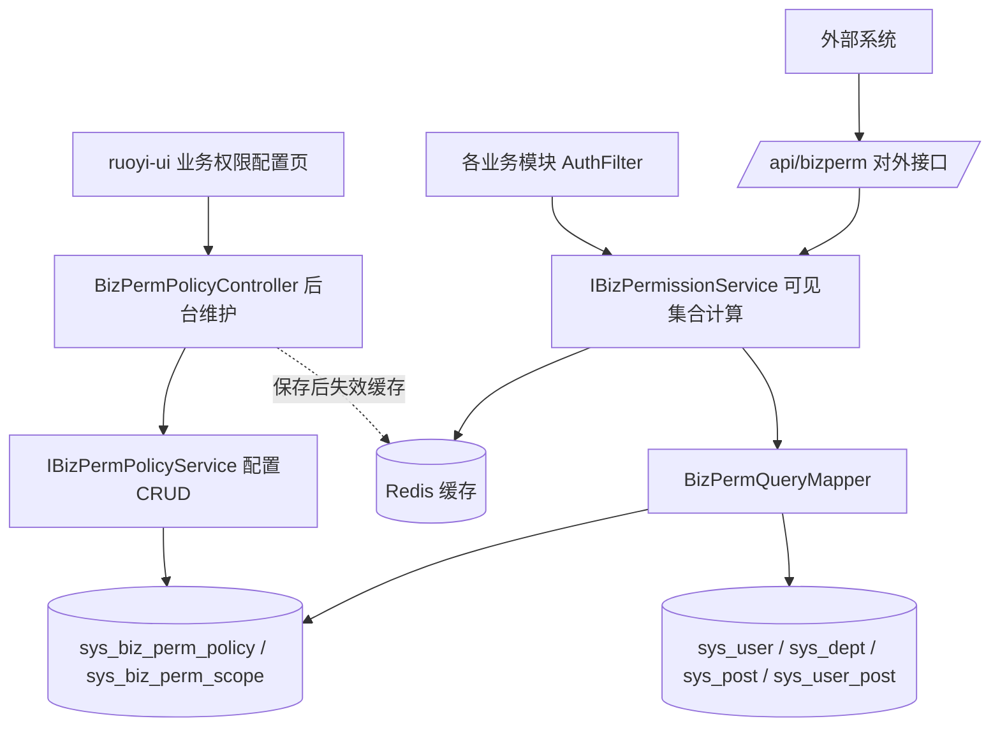

# 通用业务级权限体系（可见人员集合）需求开发方案

> 中文名称：业务级权限体系需求开发方案

| 项目 | 内容 |
|------|------|
| 文档版本 | v1.2 |
| 编写日期 | 2026-11-03 |
| 本次更新 | 补充核心目标对齐（树形展示、跨部门可见、按工号查询），新增“我的权限”只读视图与树形接口 |
| 适用系统 | 当前 EBS / 若依管理平台（`d:\ebs-api`） |
| 文档状态 | 待评审 |
| SQL 方言 | SQL Server（`getdate()` / `CHARINDEX` / `TRY_CAST`，禁止 `limit`、`now()`、`date_format`，分页统一交 PageHelper） |

---

## 1. 现状对齐

### 1.1 当前技术栈

| 层级 | 现状 |
|------|------|
| 后端 | Spring Boot 4.0.6、Java 17、MyBatis、Druid、PageHelper、FastJSON2 |
| 数据库 | SQL Server |
| 认证 | Spring Security + JWT；对外接口通过 `/api/auth/token` 用 API Key + Secret 换取 Token，`ApiKeyAuthenticationFilter` 已覆盖 `/api/**` |
| 前端 | 当前仓库实际前端为 `ruoyi-ui`（Vue 2 + Element UI 2.15.14 + vue-cli） |
| 模块化参考 | `ruoyi-apilog` 已是独立公共模块（根 `pom.xml` 注册 + `ruoyi-admin` 依赖 + `resources/mapper` 扫描） |

### 1.2 可复用的组织与权限能力

| 能力 | 现状 | 对本方案的支撑 |
|------|------|----------------|
| 工号 | `sys_user.user_name` 即工号，`SyncOrgTask` 以接口 `fd_no` 写入 | 对外接口统一以工号作为人员唯一标识 |
| 部门树 | `sys_dept.ancestors` 形如 `,100,101,`，SQL 中可用 `CHARINDEX` 判断父子关系 | 支撑“部门含下级递归” |
| 岗位 | `sys_post` + `sys_user_post` | 支撑“按岗位”配置与计算 |
| 用户状态 | `sys_user.status='0'` 且 `del_flag='0'` 为有效人员 | 可见集合统一过滤停用/删除人员 |
| 角色数据权限 | `DataScopeAspect` 按角色拼接 `${params.dataScope}`，支持全部/自定义/本部门/本部门及以下/仅本人 | 与新体系并存，不改造（属框架红区） |
| 对外认证 | API Key + JWT，`/api/**` 自动鉴权 | 外部系统按工号查询接口可直接复用 |
| 操作日志 | `@Log` + `ruoyi-apilog` 入站日志过滤器 | 配置变更留痕、外部调用自动记录 |

### 1.3 现状缺口

1. 没有统一的业务权限配置表和后台维护页面，权限范围分散在代码或角色数据权限中，业务调整必须改代码或改角色。
2. 没有“当前人可见人员集合”的统一计算服务，各业务模块会各写一套过滤逻辑，口径不一致。
3. 现有 `@DataScope` 只支持“角色 + 部门”维度，无法按人员/岗位/部门混合配置某个业务场景的可见人员范围。
4. 没有面向外部系统的、按工号查询权限范围的 JSON 接口。
5. 当前仓库各业务模块尚未形成统一的 `AuthFilter`，缺一个可复用的接入基类。

---

## 2. 需求范围

### 2.1 四项需求与实现落点

| 编号 | 需求 | 实现落点 |
|------|------|----------|
| R1 | 唯一的数据权限配置入口（后台可视化维护），业务管理员可新增/修改/停用，无需开发介入 | 独立模块 `ruoyi-bizperm` + 配置表 + 后台 CRUD 接口 + `ruoyi-ui` 页面 + 菜单/按钮权限 |
| R2 | 统一的“当前人可见人员集合”计算服务，全部模块 AuthFilter 调用同一 Service 方法 | `IBizPermissionService#getVisibleUserCodes(policyCode, userCode)` + 抽象过滤器 `AbstractBizAuthFilter` |
| R3 | 支持按人员/岗位/部门（含下级递归）配置权限范围 | 授权对象与可见范围均支持 `USER / POST / DEPT` 三类，部门支持“含下级”开关 |
| R4 | 外部系统按工号远程查询权限范围（JSON 接口） | `/api/bizperm/**` 对外接口，复用 API Key + JWT 认证 |

### 2.2 不在本期范围

- 不改造 `DataScopeAspect`、`ruoyi-framework`、`ruoyi-system` 等框架核心模块。
- 不做字段级、按钮级数据脱敏（仍由现有菜单权限 `@PreAuthorize` 负责）。
- 不做权限申请/审批流、不做权限有效期（后续可扩展生效/失效时间字段）。
- 不做按“汇报线/直接上级”递归（`fd_short_no` 仅作为后续扩展点记录）。
- 不改造组织同步任务（`ruoyi-quartz` 属红区，见“风险与依赖”）。

### 2.3 核心概念

| 概念 | 说明 | 示例 |
|------|------|------|
| 业务权限场景 `policy_code` | 一个业务模块/页面对应的可见范围编码，全局唯一登记 | `customer:view`、`opportunity:view` |
| 授权对象 `subject` | 被赋予可见范围的身份，支持人员/岗位/部门 | 岗位=销售经理 |
| 可见范围 `scope` | 该授权对象能看到的人员集合，支持人员/岗位/部门（可含下级） | 部门=华东大区（含下级） |
| 可见人员集合 | 当前人命中所有启用策略后，展开去重的有效工号集合 | `["10001","10002"]` |

> 说明：R3 中的“按人员/岗位/部门配置权限范围”落在 `scope` 上；同时授权对象 `subject` 也支持三类，便于“整个岗位/整个部门统一授权”，两类配置共用同一套枚举，不额外增加模型。

### 2.4 核心目标对齐（v1.2 补充）

| 编号 | 核心目标 | 设计响应 | 落点 |
|------|----------|----------|------|
| G1 | 页面清晰展示权限结构，可为树形结构 | 主视图采用四级树：**权限归属人 → 业务场景 → 配置部门（跨部门并列）→ 员工**；支持懒加载、搜索、节点统计（部门数/员工数）和跨部门标签 | 6.1、6.2 |
| G2 | 权限归属人可查看配置部门所在所有员工，包括配置的跨部门 | 一个权限归属人可挂多个部门（`scope` 多条 `DEPT` 记录，天然支持跨部门）；每条范围独立控制“含下级”；新增“我的权限”只读视图，按当前登录人工号展示自己的树和员工清单 | 5.2、6.1、6.2 |
| G3 | 提供接口给外部或后端使用，通过员工工号 | 对外 `GET /api/bizperm/visible-users?userCode=`；后端 `IBizPermissionService#getVisibleUserCodes(policyCode, userCode)`；均以工号为唯一入参 | 5.1、8 |

> 术语：“权限归属人”即本方案中的授权对象（`subject`），本期以人员为主；岗位/部门作为归属人保留兼容，不改变数据模型。
>
> 树形形态说明：推荐“归属人 → 场景 → 部门 → 员工”，可直接回答“谁、在哪个场景、能看哪些部门的人”。若业务更习惯“场景 → 部门 → 归属人”，仅调整前端组装顺序，后端接口与数据结构不变（见 Q12）。

---

## 3. 总体设计

### 3.1 架构图



### 3.2 模块归属

新增独立 Maven 模块 `ruoyi-bizperm`（目录已存在，需补全并注册）：

```
ruoyi-bizperm/
└── src/main/
    ├── java/com/ruoyi/bizperm/
    │   ├── constant/BizPermConstants.java          # 枚举与常量（USER/POST/DEPT、缓存 key）
    │   ├── domain/BizPermPolicy.java               # 权限策略主表实体
    │   ├── domain/BizPermScope.java                # 可见范围明细实体
    │   ├── domain/bo/BizPermPolicyBo.java          # 新增/修改入参
    │   ├── domain/vo/BizPermUserVo.java            # 可见人员出参
    │   ├── mapper/BizPermPolicyMapper.java         # 配置与计算 SQL
    │   ├── service/IBizPermPolicyService.java      # 配置维护
    │   ├── service/IBizPermissionService.java      # 统一可见集合计算（R2 核心）
    │   ├── service/impl/BizPermPolicyServiceImpl.java
    │   ├── service/impl/BizPermissionServiceImpl.java
    │   ├── filter/AbstractBizAuthFilter.java       # 业务模块统一过滤器基类
    │   ├── support/BizPermContext.java             # request 作用域结果读取
    │   └── controller/
    │       ├── BizPermPolicyController.java        # 后台配置入口（R1）
    │       └── ApiBizPermController.java           # 对外查询（R4）
    └── resources/
        ├── mapper/bizperm/BizPermPolicyMapper.xml
        └── sql/bizperm/sys_biz_perm_policy.sql     # 建表 + 索引 + 菜单 + 字典
```

模块依赖：仅依赖 `ruoyi-common` 与 `spring-boot-starter-webmvc`（与 `ruoyi-apilog` 一致），不依赖 `ruoyi-system`，避免与框架模块耦合；组织数据通过自有 Mapper 只读查询。

### 3.3 与现有数据权限的关系

| 维度 | 现有 `@DataScope` | 本方案 |
|------|-------------------|--------|
| 授权依据 | 角色 | 业务场景 + 人员/岗位/部门 |
| 过滤对象 | 部门/用户（角色自定义部门） | 人员可见集合（工号） |
| 作用方式 | AOP 拼接 SQL 片段 | Service 计算集合，业务模块自行用于查询条件 |
| 关系 | 保持不变 | 独立增量能力；如某模块需两者同时生效，由该模块取交集 |

---

## 4. 数据模型（SQL Server）

### 4.1 权限策略主表 `sys_biz_perm_policy`

| 字段 | 类型 | 说明 |
|------|------|------|
| id | bigint identity | 主键 |
| policy_code | nvarchar(64) | 业务权限场景编码，如 `customer:view` |
| policy_name | nvarchar(100) | 场景名称（冗余展示） |
| subject_type | nvarchar(16) | 授权对象类型：`USER`/`POST`/`DEPT` |
| subject_value | nvarchar(64) | 授权对象值：工号 / 岗位ID / 部门ID |
| subject_name | nvarchar(100) | 授权对象名称（冗余，便于列表展示） |
| include_child | nchar(1) | 授权对象为部门时是否含下级：`0`否 `1`是 |
| status | nchar(1) | 状态：`0`启用 `1`停用 |
| remark | nvarchar(500) | 备注 |
| create_by / create_time / update_by / update_time | - | 审计字段 |

唯一约束：同一场景 + 同一授权对象仅允许一条有效记录。

### 4.2 可见范围明细表 `sys_biz_perm_scope`

| 字段 | 类型 | 说明 |
|------|------|------|
| id | bigint identity | 主键 |
| policy_id | bigint | 关联策略主表 `id` |
| scope_type | nvarchar(16) | 范围类型：`USER`/`POST`/`DEPT` |
| scope_value | nvarchar(64) | 工号 / 岗位ID / 部门ID |
| scope_name | nvarchar(100) | 范围名称（冗余展示） |
| include_child | nchar(1) | 部门是否含下级：`0`否 `1`是 |
| order_num | int | 排序 |
| create_by / create_time / update_by / update_time | - | 审计字段 |

### 4.3 建表脚本

```sql
-- 业务权限策略主表
CREATE TABLE [dbo].[sys_biz_perm_policy] (
    [id] bigint IDENTITY(1,1) NOT NULL PRIMARY KEY,
    [policy_code] nvarchar(64) NOT NULL,
    [policy_name] nvarchar(100) NOT NULL,
    [subject_type] nvarchar(16) NOT NULL,
    [subject_value] nvarchar(64) NOT NULL,
    [subject_name] nvarchar(100) NULL,
    [include_child] nchar(1) NOT NULL DEFAULT '0',
    [status] nchar(1) NOT NULL DEFAULT '0',
    [remark] nvarchar(500) NULL,
    [create_by] nvarchar(64) NULL,
    [create_time] datetime2(7) NULL DEFAULT getdate(),
    [update_by] nvarchar(64) NULL,
    [update_time] datetime2(7) NULL
);

CREATE UNIQUE INDEX [uk_biz_perm_policy] ON [dbo].[sys_biz_perm_policy] ([policy_code], [subject_type], [subject_value]);
CREATE INDEX [idx_biz_perm_policy_subject] ON [dbo].[sys_biz_perm_policy] ([subject_type], [subject_value], [status]);

-- 业务权限可见范围明细表
CREATE TABLE [dbo].[sys_biz_perm_scope] (
    [id] bigint IDENTITY(1,1) NOT NULL PRIMARY KEY,
    [policy_id] bigint NOT NULL,
    [scope_type] nvarchar(16) NOT NULL,
    [scope_value] nvarchar(64) NOT NULL,
    [scope_name] nvarchar(100) NULL,
    [include_child] nchar(1) NOT NULL DEFAULT '0',
    [order_num] int NOT NULL DEFAULT 0,
    [create_by] nvarchar(64) NULL,
    [create_time] datetime2(7) NULL DEFAULT getdate(),
    [update_by] nvarchar(64) NULL,
    [update_time] datetime2(7) NULL
);

CREATE INDEX [idx_biz_perm_scope_policy] ON [dbo].[sys_biz_perm_scope] ([policy_id]);
```

> 约定：沿用若依风格，不建物理外键；删除策略时在同一事务内删除范围明细。

### 4.4 菜单与权限（后台配置入口）

```sql
SET IDENTITY_INSERT [dbo].[sys_menu] ON;

INSERT INTO [dbo].[sys_menu] ([menu_id], [menu_name], [parent_id], [order_num], [path], [component], [query], [route_name], [is_frame], [is_cache], [menu_type], [visible], [status], [perms], [icon], [create_by], [create_time], [update_by], [update_time], [remark])
VALUES ('2100', '业务权限配置', '1', '10', 'bizperm', 'bizperm/policy/index', '', '', 1, 0, 'C', '0', '0', 'bizperm:policy:list', 'lock', 'admin', getdate(), '', NULL, '业务级权限配置菜单');

INSERT INTO [dbo].[sys_menu] ([menu_id], [menu_name], [parent_id], [order_num], [path], [component], [query], [route_name], [is_frame], [is_cache], [menu_type], [visible], [status], [perms], [icon], [create_by], [create_time], [update_by], [update_time], [remark])
VALUES ('2101', '权限查询', '2100', '1', '', '', '', '', 1, 0, 'F', '0', '0', 'bizperm:policy:query', '#', 'admin', getdate(), '', NULL, '');

INSERT INTO [dbo].[sys_menu] ([menu_id], [menu_name], [parent_id], [order_num], [path], [component], [query], [route_name], [is_frame], [is_cache], [menu_type], [visible], [status], [perms], [icon], [create_by], [create_time], [update_by], [update_time], [remark])
VALUES ('2102', '权限新增', '2100', '2', '', '', '', '', 1, 0, 'F', '0', '0', 'bizperm:policy:add', '#', 'admin', getdate(), '', NULL, '');

INSERT INTO [dbo].[sys_menu] ([menu_id], [menu_name], [parent_id], [order_num], [path], [component], [query], [route_name], [is_frame], [is_cache], [menu_type], [visible], [status], [perms], [icon], [create_by], [create_time], [update_by], [update_time], [remark])
VALUES ('2103', '权限修改', '2100', '3', '', '', '', '', 1, 0, 'F', '0', '0', 'bizperm:policy:edit', '#', 'admin', getdate(), '', NULL, '');

INSERT INTO [dbo].[sys_menu] ([menu_id], [menu_name], [parent_id], [order_num], [path], [component], [query], [route_name], [is_frame], [is_cache], [menu_type], [visible], [status], [perms], [icon], [create_by], [create_time], [update_by], [update_time], [remark])
VALUES ('2104', '权限删除', '2100', '4', '', '', '', '', 1, 0, 'F', '0', '0', 'bizperm:policy:remove', '#', 'admin', getdate(), '', NULL, '');

SET IDENTITY_INSERT [dbo].[sys_menu] OFF;
```

> 执行前先确认 `SELECT MAX(menu_id) FROM sys_menu`，避免与现有菜单冲突。管理员默认拥有全部菜单；其他角色需在“角色管理”中勾选。

---

## 5. 统一可见人员集合计算服务（R2 核心）

### 5.1 服务接口

```java
package com.ruoyi.bizperm.service;

import java.util.List;
import java.util.Set;
import com.ruoyi.bizperm.domain.vo.BizPermUserVo;

/**
 * 业务权限可见人员集合计算服务
 *
 * @author Zhang zhan
 * @date 2026-11-03
 */
public interface IBizPermissionService {

    /**
     * 查询指定业务场景下，当前人可见的人员工号集合
     *
     * @param policyCode 业务权限场景编码
     * @param userCode   当前人工号（sys_user.user_name）
     * @return 去重后的有效工号集合，无权限时返回空集合
     */
    Set<String> getVisibleUserCodes(String policyCode, String userCode);

    /**
     * 查询指定业务场景下，当前人可见的人员明细
     *
     * @param policyCode 业务权限场景编码
     * @param userCode   当前人工号
     * @return 人员明细列表
     */
    List<BizPermUserVo> getVisibleUsers(String policyCode, String userCode);

    /**
     * 判断目标工号是否在当前人可见范围内
     *
     * @param policyCode     业务权限场景编码
     * @param userCode       当前人工号
     * @param targetUserCode 目标工号
     * @return true 可见
     */
    boolean isUserVisible(String policyCode, String userCode, String targetUserCode);

    /**
     * 清理指定场景的可见集合缓存
     *
     * @param policyCode 业务权限场景编码，为空时清理全部
     */
    void evictCache(String policyCode);
}
```

### 5.2 计算规则

1. **超级管理员**：`userId = 1` 直接返回全部有效人员（`status='0'` 且 `del_flag='0'`），与现有 `DataScopeAspect` 的超管行为保持一致。
2. **命中授权对象**：在指定 `policy_code` 下，查找状态为启用的策略，满足任一条件即命中：
   - `subject_type='USER'` 且 `subject_value = 当前人工号`；
   - `subject_type='POST'` 且 `subject_value` 属于当前人的启用岗位；
   - `subject_type='DEPT'` 且 `subject_value = 当前人部门`；或 `include_child='1'` 且当前人部门在该部门子树内。
3. **范围展开**：对所有命中策略的范围明细做并集：
   - `USER`：该工号本人；
   - `POST`：拥有该启用岗位的全部有效人员；
   - `DEPT`：该部门下有效人员；`include_child='1'` 时包含全部子孙部门人员。
4. **过滤**：统一剔除 `sys_user.status='1'`、`del_flag<>'0'` 的人员；递归展开部门时只走 `sys_dept.status='0'`、`del_flag='0'` 的部门。
5. **无配置兜底**：当前人未命中任何启用策略时，按配置 `bizperm.default-allow-all`（默认 `false`）返回空集合，体现最小权限原则；如业务要求“未配置即全员可见”，改为 `true`。
6. **去重与稳定排序**：结果按工号升序去重，工号集合用于缓存与外部接口。

### 5.3 查询 SQL（SQL Server）

查询当前人有效策略：

```sql
SELECT p.id, p.policy_code, p.policy_name, p.subject_type, p.subject_value, p.include_child
FROM sys_biz_perm_policy p
WHERE p.status = '0'
  AND p.policy_code = #{policyCode}
  AND (
        (p.subject_type = 'USER' AND p.subject_value = #{userCode})
        OR (p.subject_type = 'POST' AND EXISTS (
              SELECT 1
              FROM sys_user_post up
              INNER JOIN sys_post po ON po.post_id = up.post_id AND po.status = '0'
              WHERE up.user_id = #{userId}
                AND up.post_id = TRY_CAST(p.subject_value AS BIGINT)
        ))
        OR (p.subject_type = 'DEPT' AND EXISTS (
              SELECT 1
              FROM sys_dept cur
              WHERE cur.dept_id = #{deptId}
                AND cur.status = '0'
                AND cur.del_flag = '0'
                AND (
                      cur.dept_id = TRY_CAST(p.subject_value AS BIGINT)
                      OR (p.include_child = '1'
                          AND CHARINDEX(',' + p.subject_value + ',', ',' + cur.ancestors + ',') > 0)
                )
        ))
  )
```

展开可见人员（`policyIds` 为空时不执行 SQL，直接返回空集合）：

```sql
SELECT DISTINCT
       u.user_id   AS userId,
       u.user_name AS userCode,
       u.nick_name AS nickName,
       u.dept_id   AS deptId,
       d.dept_name AS deptName
FROM sys_biz_perm_scope s
INNER JOIN sys_user u ON u.status = '0' AND u.del_flag = '0'
LEFT JOIN sys_dept d ON d.dept_id = u.dept_id
WHERE s.policy_id IN
      <foreach collection="policyIds" item="id" open="(" separator="," close=")">#{id}</foreach>
  AND (
        (s.scope_type = 'USER' AND u.user_name = s.scope_value)
        OR (s.scope_type = 'POST' AND EXISTS (
              SELECT 1
              FROM sys_user_post up
              INNER JOIN sys_post po ON po.post_id = up.post_id AND po.status = '0'
              WHERE up.user_id = u.user_id
                AND up.post_id = TRY_CAST(s.scope_value AS BIGINT)
        ))
        OR (s.scope_type = 'DEPT' AND EXISTS (
              SELECT 1
              FROM sys_dept sd
              WHERE sd.dept_id = u.dept_id
                AND sd.status = '0'
                AND sd.del_flag = '0'
                AND (
                      (s.include_child = '0' AND sd.dept_id = TRY_CAST(s.scope_value AS BIGINT))
                      OR (s.include_child = '1'
                          AND (sd.dept_id = TRY_CAST(s.scope_value AS BIGINT)
                               OR CHARINDEX(',' + s.scope_value + ',', ',' + sd.ancestors + ',') > 0))
                )
        ))
  )
```

> 兼容性说明：以上 SQL 未使用 `limit`、`now()`、`date_format` 等 MySQL 语法；查询结果集不需要分页，若后台列表需分页统一交 PageHelper。

### 5.4 缓存设计

| 项目 | 方案 |
|------|------|
| 缓存介质 | Redis（复用 `RedisCache`） |
| Key | `bizperm:visible:{policyCode}:{userCode}` |
| Value | 工号集合（仅存工号，避免大对象） |
| TTL | 默认 1800 秒，配置项 `bizperm.cache-ttl-seconds` |
| 失效时机 | 配置新增/修改/停用/删除、手动“刷新缓存”按钮 |
| 组织变更 | 组织同步任务会改变部门/岗位，不建议强依赖实时失效（见风险），用 TTL + 手动刷新兜底 |
| 空结果 | 同样缓存空集合，防止未授权请求反复查库（TTL 可缩短至 300 秒） |

配置项建议：

```yaml
bizperm:
  # 是否启用 Redis 缓存
  cache-enabled: true
  # 缓存有效期（秒）
  cache-ttl-seconds: 1800
  # 未命中任何策略时是否默认全员可见（false=最小权限）
  default-allow-all: false
```

---

## 6. 后台可视化配置入口（R1）

### 6.1 页面设计（`ruoyi-ui`，Vue2 + Element UI）

采用“树形视图为主、列表视图为辅”的双视图，两个视图共用同一份数据。

#### 视图一：权限结构树（默认）

```text
权限归属人：张三（10001）  [客户场景 1 个 / 可见 164 人]
└── 业务场景：客户查看范围（customer:view）
    ├── 部门：华东大区（含下级，128 人）
    │   ├── 员工：10002 李四（销售一部）
    │   └── ...
    └── 部门：华南大区（不含下级，36 人）   ← 跨部门
        └── ...
```

- **一级节点**：权限归属人（工号 + 姓名 + 状态），展示其场景数与合计可见人数；
- **二级节点**：业务场景，展示范围部门数；
- **三级节点**：配置部门，展示“含下级/不含下级”标签和员工数；跨部门配置时以多个并列部门节点呈现；
- **四级节点**：员工（工号、姓名、所属部门），懒加载 + 分页，避免一次性渲染大量节点；
- 顶部支持按工号、姓名、场景编码搜索；节点右键/按钮可打开“员工清单”抽屉；
- 停用的策略、停用的人员置灰并标注，便于识别。

#### 视图二：策略列表（管理维护用）

字段：场景编码、场景名称、权限归属人、含下级、状态、更新时间、操作（修改/停用启用/删除）。

#### 我的权限（只读）

- 普通用户进入页面时，只展示自己作为权限归属人的子树，不能编辑；
- 管理员默认看全部归属人，可切换到“我的权限”查看本人；
- 只读视图复用同一棵树组件，通过 `ownerUserCode` 过滤，避免维护两套页面。

#### 操作流程

1. 点击“新增”打开抽屉/弹窗，分两块：
   - **基本信息**：业务场景（下拉，来源场景注册表/字典，同时允许手工输入）、权限归属人类型（人员/岗位/部门，默认人员）、权限归属人选择器、状态、备注。
   - **可见范围**：以部门为主，可添加多行部门并支持跨部门；每行独立勾选“含下级”；也可补充人员/岗位范围。
2. 人员选择复用现有 `views/system/role/selectUser.vue` 的弹窗交互；部门使用 `treeselect`（`/system/dept/treeselect`，开启多选）；岗位下拉使用 `/system/post/optionselect`。
3. 保存前调用预览接口，展示该归属人的可见人数与样例，确认后再保存。
4. 列表操作“停用/启用”直接调用状态接口，不再弹编辑框。

#### 校验规则

- `policyCode` 必填，格式 `^[a-zA-Z][a-zA-Z0-9:_-]{1,63}$`；
- 同一场景下权限归属人不可重复（后端唯一索引 + 保存前校验，给出明确提示）；
- 至少配置一条可见范围；
- 同一归属人可配置多个部门，保存时按部门 ID 去重；跨部门范围合并去重后计算可见人数；
- 部门“含下级”仅在类型为 `DEPT` 时可选，默认不勾选，避免范围意外放大。

### 6.2 后端接口（后台）

| 方法 | 路径 | 说明 | 权限 |
|------|------|------|------|
| GET | `/bizperm/policy/list` | 分页查询策略（`startPage()` + `getDataTable()`） | `bizperm:policy:list` |
| GET | `/bizperm/policy/{id}` | 查询详情（含范围明细） | `bizperm:policy:query` |
| POST | `/bizperm/policy` | 新增（主表 + 明细，事务） | `bizperm:policy:add` |
| PUT | `/bizperm/policy` | 修改（先删后插明细，事务） | `bizperm:policy:edit` |
| PUT | `/bizperm/policy/changeStatus` | 启用/停用 | `bizperm:policy:edit` |
| DELETE | `/bizperm/policy/{ids}` | 批量删除 | `bizperm:policy:remove` |
| DELETE | `/bizperm/policy/cache` | 手动刷新缓存（可选加 `policyCode`） | `bizperm:policy:edit` |
| GET | `/bizperm/policy/tree` | 权限结构树（归属人 → 场景 → 部门 → 员工，懒加载） | `bizperm:policy:list` |
| GET | `/bizperm/policy/tree/children` | 树节点懒加载（按 `nodeType` + `parentId` 查询下级） | `bizperm:policy:list` |
| GET | `/bizperm/my/tree` | 我的权限树（当前登录人作为权限归属人） | 登录即可 |
| GET | `/bizperm/my/visible-users` | 我的可见员工清单（分页） | 登录即可 |

> `/bizperm/my/**` 由 `SecurityUtils.getUsername()` 取当前工号，只返回本人数据，不额外配置按钮权限；管理员如需查看他人，走 `/bizperm/policy/tree` 并显式传 `ownerUserCode`。

实现要求：

- Controller 继承 `BaseController`，增删改加 `@Log`、`@PreAuthorize`，返回 `AjaxResult`；
- Service 增删改加 `@Transactional`，保存成功后清理缓存（建议在事务提交后执行）；
- 不修改 `ruoyi-framework` / `ruoyi-system`。

### 6.3 场景字典（建议）

为避免场景编码随意填写，建议用字典统一登记，各业务模块上线时补充自己的场景：

```sql
-- 字典类型：业务权限场景
INSERT INTO sys_dict_type (dict_name, dict_type, status, create_by, create_time, remark)
VALUES ('业务权限场景', 'biz_perm_policy', '0', 'admin', getdate(), '业务级权限场景编码');

-- 字典数据示例（按实际模块补充）
INSERT INTO sys_dict_data (dict_sort, dict_label, dict_value, dict_type, css_class, list_class, is_default, status, create_by, create_time, remark)
VALUES (1, '客户查看范围', 'customer:view', 'biz_perm_policy', '', 'primary', 'N', '0', 'admin', getdate(), '客户模块可见人员范围');
```

---

## 7. AuthFilter 接入规范（R2）

### 7.1 统一基类

```java
package com.ruoyi.bizperm.filter;

import java.io.IOException;
import java.util.Set;
import jakarta.servlet.FilterChain;
import jakarta.servlet.ServletException;
import jakarta.servlet.http.HttpServletRequest;
import jakarta.servlet.http.HttpServletResponse;
import org.springframework.beans.factory.annotation.Autowired;
import org.springframework.web.filter.OncePerRequestFilter;
import com.ruoyi.bizperm.constant.BizPermConstants;
import com.ruoyi.bizperm.service.IBizPermissionService;
import com.ruoyi.common.utils.SecurityUtils;

/**
 * 业务模块统一权限过滤器基类，统一调用可见人员集合计算服务
 *
 * @author Zhang zhan
 * @date 2026-11-03
 */
public abstract class AbstractBizAuthFilter extends OncePerRequestFilter {

    @Autowired
    protected IBizPermissionService bizPermissionService;

    /**
     * 解析当前请求对应的业务权限场景编码
     *
     * @param request 当前请求
     * @return 业务权限场景编码，如 customer:view
     */
    protected abstract String resolvePolicyCode(HttpServletRequest request);

    /**
     * 计算当前人可见人员集合并写入请求上下文，供业务层读取
     *
     * @param request  当前请求
     * @param response 当前响应
     * @param chain    过滤器链
     */
    @Override
    protected void doFilterInternal(HttpServletRequest request, HttpServletResponse response, FilterChain chain)
            throws ServletException, IOException {
        String userCode = SecurityUtils.getUsername();
        String policyCode = resolvePolicyCode(request);
        Set<String> visibleUserCodes = bizPermissionService.getVisibleUserCodes(policyCode, userCode);
        request.setAttribute(BizPermConstants.ATTR_VISIBLE_USER_CODES, visibleUserCodes);
        chain.doFilter(request, response);
    }
}
```

`BizPermContext` 提供只读读取方法（从 request attribute 取集合），业务 Service 拿到集合后用于查询条件，避免同一请求重复计算。

### 7.2 各模块接入约定

1. 每个业务模块的 `AuthFilter` **必须**调用 `IBizPermissionService#getVisibleUserCodes`，禁止在模块内另写可见人员计算逻辑。
2. `policyCode` 与业务场景一一对应，并在字典 `biz_perm_policy` 登记；同一请求只计算一次（`AbstractBizAuthFilter` 已保证）。
3. 集合为空时按“无权限”处理：业务查询返回空列表，禁止回退为查全量。
4. 查询条件使用 MyBatis `foreach` 参数化绑定工号，禁止字符串拼接 SQL：

```xml
<if test="visibleUserCodes != null and visibleUserCodes.size() > 0">
    AND u.user_name IN
    <foreach collection="visibleUserCodes" item="code" open="(" separator="," close=")">
        #{code}
    </foreach>
</if>
<if test="visibleUserCodes == null or visibleUserCodes.size() == 0">
    AND 1 = 0
</if>
```

5. 超管、对外 API（`/api/**`）不经过业务 AuthFilter 时，由业务接口自身决定是否应用可见范围；对外接口默认返回登录 API Key 对应的全量数据，若需限定范围，显式传入 `userCode` 调服务计算。
6. 试点建议：先选一个业务模块（如客户列表）接入，验证口径与性能后再复制到其他模块。

---

## 8. 对外查询接口（R4）

### 8.1 认证方式

复用现有对外认证：

```
POST /api/auth/token  { "apiKey": "...", "apiSecret": "..." }
→ 返回 access_token
→ 后续请求头 Authorization: Bearer {access_token}
```

`ApiKeyAuthenticationFilter` 已覆盖 `/api/**`，无需修改 `SecurityConfig`；接口调用会自动写入 `ruoyi-apilog` 入站日志。

### 8.2 接口清单

| 方法 | 路径 | 说明 |
|------|------|------|
| GET | `/api/bizperm/visible-users?policyCode=xxx&userCode=10001&groupByDept=true&pageNum=1&pageSize=50` | 查询某人某场景的可见人员集合；`groupByDept=true` 时按部门分组返回，`users` 支持分页 |
| POST | `/api/bizperm/visible-users/batch` | 批量查询多个工号（可选，v1.1） |
| GET | `/api/bizperm/user-scope?userCode=10001` | 查询某人全部已配置场景及其可见集合 |

### 8.3 响应示例

```json
{
  "code": 200,
  "msg": "操作成功",
  "data": {
    "policyCode": "customer:view",
    "userCode": "10001",
    "total": 2,
    "userCodes": ["10002", "10003"],
    "users": [
      { "userCode": "10002", "nickName": "张三", "deptId": 101, "deptName": "销售一部" }
    ]
  }
}
```

可选参数 `groupByDept=true` 时，返回按部门分组的树形数据，便于外部系统直接渲染（`users` 仍支持 `pageNum/pageSize` 分页）：

```json
{
  "code": 200,
  "msg": "操作成功",
  "data": {
    "policyCode": "customer:view",
    "userCode": "10001",
    "total": 164,
    "departments": [
      {
        "deptId": 101,
        "deptName": "华东大区",
        "includeChild": true,
        "userCount": 128,
        "users": [
          { "userCode": "10002", "nickName": "李四", "deptId": 102, "deptName": "销售一部" }
        ]
      }
    ]
  }
}
```

> 跨部门配置时 `departments` 为多个并列节点；同一员工命中多个部门时只返回一条，`userCount` 按去重后人数统计。

错误约定：

| 场景 | code | msg |
|------|------|-----|
| 缺少 `policyCode` / `userCode` | 400 | 参数不完整 |
| 工号不存在或已停用 | 404 | 人员不存在或已停用 |
| 场景未登记 | 404 | 业务权限场景不存在 |
| 未配置权限（默认拒绝） | 200 | `userCodes` 为空集合，`total=0` |
| Token 无效 | 401 | 由 `ApiKeyAuthenticationFilter` 返回 |

### 8.4 安全与限流

- 只返回工号、姓名、部门等最小必要字段，不返回手机号、邮箱；
- 接口仅支持查询，不提供写入；
- 建议在网关或 Redis 做按 `apiKey` 的限流（如 100 次/分钟），防止外部系统高频拉取；
- 日志只记录 `policyCode`、`userCode`、结果数量与耗时。

---

## 9. 非功能与安全

| 类别 | 要求 |
|------|------|
| 性能 | 首次计算（缓存未命中）目标 P95 < 200ms；缓存命中 < 20ms；单次查询走集合 SQL，禁止循环查库 |
| 数据量 | 按 1 万人员规模设计；可见集合只缓存工号，明细按需查询 |
| 一致性 | 配置变更后主动失效缓存；组织同步依赖 TTL 兜底 |
| 安全 | 默认最小权限（未配置=空集合）；SQL 全部参数化；对外接口 API Key 鉴权 |
| 审计 | 配置增删改记录 `@Log`；外部调用由 `ruoyi-apilog` 记录 |
| 兼容 | 所有 SQL 使用 SQL Server 语法；分页使用 PageHelper；不修改框架红区模块 |

---

## 10. 开发任务拆解

| 阶段 | 任务 | 交付物 | 依赖 |
|------|------|--------|------|
| T1 | 数据库与模块骨架 | 建表/索引/菜单 SQL；`ruoyi-bizperm` 的 `pom.xml`；根 `pom.xml` 注册模块；`ruoyi-admin` 引入依赖；配置项 | 无 |
| T2 | 配置维护后端 | 实体/BO/VO/Mapper/XML；`IBizPermPolicyService`；`BizPermPolicyController`；唯一性校验；缓存失效 | T1 |
| T3 | 配置维护前端 | `api/bizperm/policy.js`；`views/bizperm/policy/index.vue`（树形视图 + 列表视图 + 我的权限只读视图）；人员/岗位/部门选择；菜单按钮权限 | T2 |
| T4 | 可见集合计算服务 | `IBizPermissionService` 实现；策略匹配 SQL；范围展开 SQL；Redis 缓存；超管与默认拒绝逻辑 | T1 |
| T5 | AuthFilter 接入 | `AbstractBizAuthFilter`；`BizPermContext`；选一个业务模块试点接入并验证口径 | T4 |
| T6 | 对外接口 | `ApiBizPermController`；单工号/全场景查询；按部门分组（`groupByDept`）；错误码；接口文档 | T4 |
| T7 | 联调与验收 | 用例回归、性能验证、菜单与权限配置、文档更新 | T2~T6 |

建议并行：T3 与 T4 可并行；T5、T6 在 T4 完成后并行。

---

## 11. 验收标准

### 11.1 功能验收

| 编号 | 用例 | 预期 |
|------|------|------|
| AC1 | 业务管理员在后台新增一条“人员 → 部门（含下级）”策略 | 保存成功，列表可见，无需开发介入 |
| AC2 | 修改策略的可见范围 | 明细整体替换成功，旧缓存失效，下次计算生效 |
| AC3 | 停用策略 | 该策略不再参与计算 |
| AC4 | 当前人命中“人员”授权对象 | 可见集合等于其配置范围 |
| AC5 | 当前人命中“岗位”授权对象 | 可见集合等于该岗位下所有启用人员的配置范围并集 |
| AC6 | 部门不含下级 | 仅该部门直属人员 |
| AC7 | 部门含下级 | 该部门及全部子孙部门人员 |
| AC8 | 范围内人员停用/删除 | 不出现在结果中 |
| AC9 | 未配置任何策略 | 默认返回空集合（`default-allow-all=false`） |
| AC10 | 超管访问 | 返回全部有效人员 |
| AC11 | 外部系统用 API Key 换 Token 后按工号查询 | 返回标准 JSON，字段与示例一致 |
| AC12 | 缺少参数 / 工号不存在 | 返回约定错误码与提示 |
| AC13 | 同一场景重复配置同一授权对象 | 后端拒绝并提示 |
| AC14 | 业务模块 AuthFilter 接入 | 与配置结果一致，空集合时返回空列表 |
| AC15 | 缓存 | 第二次请求命中缓存；修改配置后缓存被清除 |
| AC16 | 权限结构树展示 | 按“归属人 → 场景 → 部门 → 员工”展开，节点人数统计正确，跨部门以多个并列节点展示 |
| AC17 | 权限归属人查看“我的权限” | 只展示本人作为归属人的子树，覆盖其配置的全部部门（跨部门合并去重），只读不可编辑 |
| AC18 | 外部接口树形返回 | `groupByDept=true` 时按部门分组返回员工，跨部门节点并列，分页与去重正确 |

### 11.2 质量验收

- 新增代码全部位于 `ruoyi-bizperm` 与 `ruoyi-ui` 业务目录，未修改 `ruoyi-framework`、`ruoyi-system` 等红区模块；
- SQL 全部为 SQL Server 兼容语法，无 `limit`、`now()`、`date_format`；
- 新增 Java 文件包含 `@author` / `@date` 注释，方法含功能与参数说明；
- 配置类接口均有 `@PreAuthorize` 与 `@Log`；
- 对外接口不返回敏感字段；
- 编译通过，核心用例 AC1~AC18 全部通过。

---

## 12. 待确认事项（需业务/技术确认后锁定）

| 编号 | 问题 | 建议方案 |
|------|------|----------|
| Q1 | 工号是否确定取 `sys_user.user_name`？ | 当前 `SyncOrgTask` 以 `fd_no` 写入 `user_name`，建议确认后全系统统一以该字段为工号 |
| Q2 | 未配置权限的人默认可见范围？ | 建议默认拒绝（空集合）；如业务要求全员可见，配置 `default-allow-all=true` |
| Q3 | 授权对象是否需要岗位/部门（还是仅人员）？ | 方案已支持三类，页面可按需隐藏；仅人员时不影响数据结构 |
| Q4 | 新体系与现有角色数据权限是否叠加？ | 建议互不影响；需要叠加的模块取交集，并在该模块文档中注明 |
| Q5 | 部门停用后，其人员是否仍可见？ | 建议人员只按自身状态过滤，递归展开时跳过停用部门，避免误伤在职人员 |
| Q6 | 是否需要权限有效期？ | 本期不做，后续在策略表增加 `effective_start` / `effective_end` 并纳入 SQL 条件 |
| Q7 | 组织同步后缓存是否要求实时失效？ | `SyncOrgTask` 属红区，不建议直接改；采用 TTL（建议 10~30 分钟）+ 后台手动刷新；如需实时，需明确授权修改该任务 |
| Q8 | 外部系统是否需要批量/增量同步？ | 本期提供单工号与全场景查询；批量接口列为 v1.1 |
| Q9 | 是否引入显式拒绝（DENY）与优先级？ | 建议本期引入，能覆盖“部门可见但排除个别人员”的高频场景（见 P0-2） |
| Q10 | 是否建立场景注册表并按场景设置默认效果？ | 建议建立，替代全局 `default-allow-all`，同时便于场景覆盖统计（见 P0-3） |
| Q11 | 是否接受 SQL 下推改造（需业务模块配合）？ | 建议先在一个人员量大的模块试点，验证后再推广；小范围场景继续用集合接口（见 P0-5） |
| Q12 | 权限树的根节点用“归属人”还是“场景”？ | 建议“归属人 → 场景 → 部门 → 员工”，贴合“权限归属人查看自己范围”；如更习惯“场景优先”，仅调整前端组装顺序 |
| Q13 | “我的权限”是否允许查看他人？ | 建议普通用户仅本人只读；管理员通过策略树查看全部，并可切换到本人视图 |
| Q14 | 部门范围默认是否含下级？ | 建议默认不含，由每条范围显式勾选“含下级”，避免范围意外放大 |

---

## 13. 行业对标与优化路线（当前方案 + 演进）

> 说明：第 1~12 章为可快速落地的 MVP 基线；本章为行业对标结论与演进路线。若评审采纳 P0 项，应在开发启动前合并进第 4 章数据模型，避免二次改表。

### 13.1 对标结论

当前方案已覆盖四项核心需求，属于“可用的可见人员白名单”方案。与 AWS IAM、Salesforce Sharing、Casbin、OpenFGA/SpiceDB、MyBatis-Plus 数据权限等市面成熟方案相比，主要差距集中在四处：

1. **表达力**：只有允许（白名单并集），没有显式拒绝、排除规则和优先级。
2. **执行方式**：把人员集合拉到内存再 `IN (...)`，大范围场景存在参数膨胀和大对象缓存问题。
3. **一致性**：依赖 TTL + 手动刷新，组织调岗后存在最长一个缓存周期的不一致。
4. **治理能力**：缺配置预览、影响面分析、变更 diff、版本回滚和定期复核。

### 13.2 行业对标总览

| 维度 | 市面主流做法 | 当前方案 | 差距与风险 |
|------|--------------|----------|------------|
| 权限模型 | AWS IAM：允许 + 显式拒绝 + 条件 + 优先级；Salesforce：共享规则 + 条件共享 + 手动共享 | 纯白名单并集 | 无法表达“整个部门可见，但排除某几个人” |
| 决策方式 | PDP/PEP 分离，提供 `check` / `explain` 决策接口 | 只返回集合，业务自行解释 | 各模块二次解释集合，口径容易再次分裂 |
| 执行方式 | MyBatis-Plus 数据权限拦截器：条件下推 SQL；Salesforce 异步重算共享表 | 先算工号集合再 `IN (...)` | 万人员时参数膨胀、缓存对象大、易退化为全量扫描 |
| 规模化 | 物化映射表 / 位图 / 闭包表 + 异步重算 | 实时递归 + Redis 存集合 | 部门层级深或人员多时，计算与内存成本线性增长 |
| 组织递归 | 闭包表、`hierarchyid`、预计算路径 | `ancestors` + `CHARINDEX` | `ancestors` 仅 `nvarchar(50)`，深层级可能截断；`CHARINDEX` 无法走索引 |
| 变更一致性 | 事件驱动 + 版本号（Casbin watcher、Zanzibar zookie） | TTL + 手动刷新 + 按 pattern 清缓存 | 调岗后最长 30 分钟不一致；批量删 key 在生产环境可能阻塞 |
| 治理能力 | 权限预览、影响面分析、变更 diff、定期复核、版本回滚 | CRUD + `@Log` | 误配难发现、难回滚；审计只知“改过”不知“改了什么” |
| 对外集成 | OAuth2 Client Credentials + Scope、批量、变更订阅、HMAC/mTLS、限流、SDK | API Key 换 JWT、单工号查询 | 无法按应用限定可查场景；高频拉取无保护；外部无法感知权限变更 |

### 13.3 P0：建议本期吸收的优化

#### P0-1 数据模型类型安全化

当前 `subject_value / scope_value` 用 `nvarchar(64)` 混存工号、岗位 ID、部门 ID，查询必须 `TRY_CAST(... AS BIGINT)`，会导致 `post_id / dept_id` 索引失效。建议拆分为：

| 字段 | 类型 | 用途 |
|------|------|------|
| subject_type | nvarchar(16) | `USER` / `POST` / `DEPT` |
| subject_id | bigint | 岗位 ID、部门 ID（`USER` 时为空） |
| subject_code | nvarchar(64) | 人员工号（`POST` / `DEPT` 时为空） |
| scope_type | nvarchar(16) | 同上 |
| scope_id | bigint | 岗位 ID、部门 ID |
| scope_code | nvarchar(64) | 人员工号 |

对应索引（已建表时执行，未建表则直接并入第 4 章 `CREATE TABLE`）：

```sql
ALTER TABLE [dbo].[sys_biz_perm_policy] ADD [subject_id] bigint NULL;
ALTER TABLE [dbo].[sys_biz_perm_policy] ADD [subject_code] nvarchar(64) NULL;
ALTER TABLE [dbo].[sys_biz_perm_scope] ADD [scope_id] bigint NULL;
ALTER TABLE [dbo].[sys_biz_perm_scope] ADD [scope_code] nvarchar(64) NULL;

CREATE INDEX [idx_biz_perm_policy_subject_id] ON [dbo].[sys_biz_perm_policy] ([policy_code], [subject_type], [subject_id], [status]);
CREATE INDEX [idx_biz_perm_policy_subject_code] ON [dbo].[sys_biz_perm_policy] ([policy_code], [subject_type], [subject_code], [status]);
CREATE INDEX [idx_biz_perm_scope_target] ON [dbo].[sys_biz_perm_scope] ([policy_id], [scope_type], [scope_id]);
```

#### P0-2 增加显式拒绝（DENY）与优先级

白名单并集无法表达“部门 A 全部可见，但排除工号 10086”。建议：

- 策略主表增加 `effect`（`0`允许 `1`拒绝）与 `priority`（默认 100，数值越小优先级越高）；
- 计算规则改为“先取允许并集，再减去拒绝集合，**DENY 优先**”；
- 唯一索引需包含 `effect`，并使用过滤索引避免 NULL 冲突：

```sql
ALTER TABLE [dbo].[sys_biz_perm_policy] ADD [effect] nchar(1) NOT NULL CONSTRAINT [df_biz_perm_policy_effect] DEFAULT '0';
ALTER TABLE [dbo].[sys_biz_perm_policy] ADD [priority] int NOT NULL CONSTRAINT [df_biz_perm_policy_priority] DEFAULT 100;

DROP INDEX [uk_biz_perm_policy] ON [dbo].[sys_biz_perm_policy];
CREATE UNIQUE INDEX [uk_biz_perm_policy_user] ON [dbo].[sys_biz_perm_policy] ([policy_code], [subject_type], [subject_code], [effect])
    WHERE [subject_type] = 'USER';
CREATE UNIQUE INDEX [uk_biz_perm_policy_org] ON [dbo].[sys_biz_perm_policy] ([policy_code], [subject_type], [subject_id], [effect])
    WHERE [subject_type] IN ('POST', 'DEPT');
```

#### P0-3 建立场景注册表

`policy_code` 仅靠字典和手填，容易出现拼写错误和“孤儿场景”。建议增加 `sys_biz_perm_scene`，同时用“场景默认效果”替代全局 `default-allow-all`：

```sql
CREATE TABLE [dbo].[sys_biz_perm_scene] (
    [scene_code] nvarchar(64) NOT NULL PRIMARY KEY,
    [scene_name] nvarchar(100) NOT NULL,
    [module_name] nvarchar(64) NULL,
    [owner] nvarchar(64) NULL,
    [default_effect] nchar(1) NOT NULL DEFAULT '1',   -- 0允许 1拒绝
    [status] nchar(1) NOT NULL DEFAULT '0',
    [remark] nvarchar(500) NULL,
    [create_by] nvarchar(64) NULL,
    [create_time] datetime2(7) NULL DEFAULT getdate(),
    [update_by] nvarchar(64) NULL,
    [update_time] datetime2(7) NULL
);
```

好处：可统计场景覆盖率、可绑定菜单/接口、可按场景设置默认允许或默认拒绝，避免所有场景共用一个全局开关。

#### P0-4 决策接口从“给集合”升级为“给结论和原因”

保留 `getVisibleUserCodes` 满足 R2，同时增加可解释决策能力：

```java
/**
 * 权限决策结果
 *
 * @author Zhang zhan
 * @date 2026-11-03
 */
public class PermissionDecision {
    /** 是否允许 */
    private boolean allowed;
    /** 决策原因 */
    private String reason;
    /** 命中的策略 */
    private java.util.List<String> matchedPolicies;
    /** 拒绝来源 */
    private java.util.List<String> deniedBy;
}

/**
 * 判断目标工号是否可见
 *
 * @param policyCode     业务场景编码
 * @param userCode       当前人工号
 * @param targetUserCode 目标工号
 * @return true 可见
 */
boolean check(String policyCode, String userCode, String targetUserCode);

/**
 * 解释可见或拒绝的原因，用于排障与审计
 *
 * @param policyCode     业务场景编码
 * @param userCode       当前人工号
 * @param targetUserCode 目标工号
 * @return 决策结果
 */
PermissionDecision explain(String policyCode, String userCode, String targetUserCode);
```

#### P0-5 大范围场景改为 SQL 下推

不要把上万工号拉到 Java 再 `IN`。建议提供 `BizPermSqlProvider`（或 MyBatis 拦截器），把可见范围作为 `EXISTS` 子查询下推到业务 SQL；集合接口仅保留给对外系统和小范围场景。示例（仅示意范围展开部分，完整实现还需拼接授权对象命中条件与 DENY 排除）：

```sql
AND EXISTS (
    SELECT 1
    FROM sys_biz_perm_policy p
    INNER JOIN sys_biz_perm_scope s ON s.policy_id = p.id
    WHERE p.policy_code = #{policyCode}
      AND p.status = '0'
      AND p.effect = '0'
      AND (
            (s.scope_type = 'USER' AND s.scope_code = u.user_name)
            OR (s.scope_type = 'POST' AND EXISTS (
                  SELECT 1
                  FROM sys_user_post up
                  INNER JOIN sys_post po ON po.post_id = up.post_id AND po.status = '0'
                  WHERE up.user_id = u.user_id AND up.post_id = s.scope_id
            ))
            OR (s.scope_type = 'DEPT' AND EXISTS (
                  SELECT 1
                  FROM sys_dept sd
                  WHERE sd.dept_id = u.dept_id
                    AND sd.status = '0'
                    AND sd.del_flag = '0'
                    AND (sd.dept_id = s.scope_id
                         OR (s.include_child = '1'
                             AND CHARINDEX(',' + CAST(s.scope_id AS NVARCHAR(32)) + ',', ',' + sd.ancestors + ',') > 0))
            ))
      )
)
```

#### P0-6 缓存版本化与事件失效

用“版本号”替代按 pattern 删除缓存，避免生产环境 `KEYS` 扫描阻塞：

| 项目 | 方案 |
|------|------|
| 版本 key | `bizperm:version:{policyCode}` |
| 数据 key | `bizperm:visible:{version}:{policyCode}:{userCode}` |
| 发布配置 | 保存/停用/删除成功后，`INCR bizperm:version:{policyCode}`，旧 key 自然过期 |
| 组织变更 | 发布“组织变更事件”，订阅方递增相关场景版本；不要求实时时可继续用 TTL 兜底 |

#### P0-7 配置治理三件套：预览、diff、回滚

- **配置预览**：新增 `POST /bizperm/policy/preview`，入参为草稿规则 + 工号，返回可见人数、样例人员和被拒绝人员，保存前即可发现误配；
- **变更留痕**：新增 `sys_biz_perm_policy_log`，记录操作前后 JSON 快照，配合 `@Log` 形成完整审计；
- **版本回滚**：策略表增加 `version` 乐观锁与逻辑删除字段，支持误删恢复；提供策略 JSON 导出/导入，便于开发、测试、生产环境迁移。

```sql
CREATE TABLE [dbo].[sys_biz_perm_policy_log] (
    [id] bigint IDENTITY(1,1) NOT NULL PRIMARY KEY,
    [policy_id] bigint NOT NULL,
    [operation] nvarchar(16) NOT NULL,          -- ADD / UPDATE / DISABLE / DELETE
    [before_json] nvarchar(max) NULL,
    [after_json] nvarchar(max) NULL,
    [oper_by] nvarchar(64) NULL,
    [oper_time] datetime2(7) NULL DEFAULT getdate(),
    [oper_ip] nvarchar(128) NULL
);

CREATE INDEX [idx_biz_perm_policy_log] ON [dbo].[sys_biz_perm_policy_log] ([policy_id], [oper_time] DESC);
```

#### P0-8 引用完整性校验

部门合并、岗位停用、人员离职都会让策略“悬空”。建议：

- 停用/删除部门或岗位时，先校验是否被策略引用，给出提示或自动置为失效；
- 定期任务扫描无效引用（工号不存在、岗位/部门已删除）并生成治理清单；
- 策略列表展示“引用有效性”标记，便于管理员批量修复。

### 13.4 P1：下一阶段演进

| 方向 | 建议 | 价值 |
|------|------|------|
| 主体扩展 | 支持角色、用户组、直接上级（`fd_short_no` 已具备） | 减少按岗位/部门重复配置 |
| 时效性 | `effective_start` / `effective_end`、临时授权到期自动失效 | 满足临时项目、合规回收 |
| 权限治理 | 权限矩阵、定期复核（access review）、离职/调岗自动回收 | 降低越权与权限膨胀风险 |
| 对外能力 | 批量查询、版本号/ETag、变更 webhook、HMAC/mTLS、IP 白名单、按 API Key 限定可查场景、限流 | 满足外部系统集成与安全审计 |
| 可观测性 | 缓存命中率、计算耗时 P95、拒绝率、配置变更次数，接入监控告警 | 提前发现性能与误配问题 |
| 回归测试 | 将 AC1~AC15 固化为策略黄金用例，规则变更自动回归 | 防止配置调整引发回归缺陷 |

### 13.5 P2：视业务需要再上

- 条件规则（ABAC，按客户区域、金额、归属人等属性判断）；
- 关系型权限（ReBAC/Zanzibar，项目成员、协作关系）；
- 多租户与数据密级；
- 完整策略表达式引擎。

以上能力会显著增加复杂度和维护成本；当前“组织三要素 + DENY 优先 + 场景注册表”已能覆盖绝大多数企业内部场景，不建议本期投入。

### 13.6 实施优先级与章节关系

| 优化项 | 落点任务 | 说明 |
|--------|----------|------|
| P0-1 类型安全模型 | T1、T4 | 建表时直接采用 `subject_id/subject_code`，避免二次改表 |
| P0-2 DENY 与优先级 | T1、T4 | 计算逻辑需同步调整，验收增加“排除人员”用例 |
| P0-3 场景注册表 | T1、T2、T3 | 配置页场景下拉改为读注册表 |
| P0-4 决策接口 | T4、T6 | 内部排障与对外解释共用 |
| P0-5 SQL 下推 | T4、T5 | 先在一个大模块试点，再推广 |
| P0-6 版本化缓存 | T2、T4 | 替换原 TTL + 手动清理方案 |
| P0-7 预览/diff/回滚 | T2、T3 | 后台配置页增强 |
| P0-8 引用完整性 | T2、T3 | 部门/岗位维护联动 |

如果本期只能额外投入三项，建议优先 **P0-1（类型安全）、P0-2（DENY）、P0-6（版本化缓存）**：改动集中在数据模型和服务实现，成本低、收益直接；P0-4、P0-5 根据人员规模和外部集成要求再决定。

---

## 附：风险与依赖

1. **组织同步**：新增人员/调岗/岗位变更由 `ruoyi-quartz` 的同步任务完成，缓存与 `sys_dept` 递归结果存在短暂不一致；通过 TTL 与手动刷新兜底。
2. **工号唯一性**：依赖 `sys_user.user_name` 唯一校验；若历史数据存在重复工号，需先治理。
3. **大数据量部门**：部门递归依赖 `sys_dept.ancestors` 与 `CHARINDEX`，需确认 `ancestors` 字段长度（当前 `nvarchar(50)`）能容纳深层级组织；超深层级需评估扩容。
4. **前端迁移**：当前仓库前端为 `ruoyi-ui`（Vue2）；若后续迁移到 `crm-web`（Vue3），仅需按同一接口重写页面，后端接口不变。
5. **模块注册**：`ruoyi-bizperm` 目录已存在但为空，T1 需补全 `pom.xml` 并在根 `pom.xml` 的 `<modules>` 与 `<dependencyManagement>` 中注册，同时在 `ruoyi-admin/pom.xml` 引入依赖，否则 Controller/Mapper 不会被扫描。
