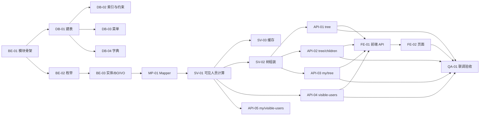

# 业务级权限体系开发任务清单

> 依据：《业务级权限体系需求开发方案》v1.2
> 范围：核心 2 张表 + 权限结构树相关接口（`tree`、`tree/children`、`my/tree`、`visible-users`）
> 技术栈：Spring Boot 4 + Java 17 + MyBatis + SQL Server + RuoYi `ruoyi-ui`（Vue2 + Element UI）
> 说明：本清单以方案第 4 章的 MVP 模型为准；第 13 章的 DENY、场景注册表、SQL 下推等 P0/P1 项不纳入本次开发。

---

## 1. 开发约定

| 项目 | 约定 |
|------|------|
| 模块 | 新建 `ruoyi-bizperm`，在根 `pom.xml` 注册，并由 `ruoyi-admin` 引入依赖 |
| 包名 | `com.ruoyi.bizperm` |
| 后台接口前缀 | `/bizperm` |
| 对外接口前缀 | `/api/bizperm`（沿用现有 API Key 换 JWT 机制） |
| 工号 | 统一取 `sys_user.user_name` |
| 状态 | `0` 启用，`1` 停用；人员过滤 `status='0' AND del_flag='0'` |
| 分页 | 后台用 `startPage()` + `getDataTable()`；对外接口手写分页，`pageSize` 最大 200 |
| 响应包装 | 后台 `AjaxResult` / `TableDataInfo`；对外统一 `code/msg/data` |
| SQL 文件 | `ruoyi-bizperm/src/main/resources/sql/bizperm/` |
| 注释 | 新增 Java 类、Mapper、XML 顶部补充 `@author` / `@date` 与中文说明 |

---

## 2. 任务总览

| 编号 | 任务 | 主要交付物 | 依赖 |
|------|------|------------|------|
| DB-01 | 核心表结构 | `sys_biz_perm_policy`、`sys_biz_perm_scope` 建表 SQL | BE-01 |
| DB-02 | 索引与约束 | 唯一索引、查询索引、过滤索引 | DB-01 |
| DB-03 | 菜单与按钮权限 | `sys_menu` 初始化 SQL | DB-01 |
| DB-04 | 场景字典 | `sys_dict_type` / `sys_dict_data` 初始化 SQL | DB-01 |
| BE-01 | 模块骨架 | `ruoyi-bizperm/pom.xml`、根 POM 注册、`ruoyi-admin` 依赖 | 无 |
| BE-02 | 枚举与常量 | `BizPermSubjectType`、`BizPermScopeType`、`BizPermNodeType` | BE-01 |
| BE-03 | 实体 / BO / VO | 实体、查询 BO、树节点 VO、可见人员 VO | BE-02 |
| MP-01 | Mapper 与 XML | 策略、范围、树节点、可见人员查询 | BE-03 |
| SV-01 | 可见人员计算服务 | `IBizPermQueryService` 及实现 | MP-01 |
| SV-02 | 树组装服务 | `IBizPermTreeService` 及实现 | SV-01 |
| SV-03 | 缓存与失效 | Redis key 规范、TTL、配置变更失效 | SV-01 |
| API-01 | `GET /bizperm/policy/tree` | 权限结构树首屏接口 | SV-02 |
| API-02 | `GET /bizperm/policy/tree/children` | 树节点懒加载接口 | SV-02 |
| API-03 | `GET /bizperm/my/tree` | 我的权限只读树接口 | SV-02 |
| API-04 | `GET /api/bizperm/visible-users` | 对外按工号查询接口 | SV-01 |
| API-05 | `GET /bizperm/my/visible-users` | 我的可见员工清单（可选） | SV-01 |
| FE-01 | 前端 API 封装 | `api/bizperm/policy.js` | API-01~04 |
| FE-02 | 树形页面与我的权限 | `views/bizperm/policy/index.vue` | FE-01 |
| QA-01 | 联调与验收 | 用例回归、性能与安全检查记录 | 全部 |

---

## 3. 数据库任务

### DB-01 核心表结构

**交付物**

- `sql/bizperm/sys_biz_perm_policy.sql`
- `sql/bizperm/sys_biz_perm_scope.sql`

**建表 SQL（SQL Server）**

```sql
-- 业务权限策略主表：一行表示“某场景下，某个权限归属人拥有哪些可见范围”
CREATE TABLE [dbo].[sys_biz_perm_policy] (
    [id] bigint IDENTITY(1,1) NOT NULL PRIMARY KEY,
    [policy_code] nvarchar(64) NOT NULL,
    [policy_name] nvarchar(100) NOT NULL,
    [subject_type] nvarchar(16) NOT NULL,          -- USER / POST / DEPT
    [subject_value] nvarchar(64) NOT NULL,         -- 工号 / 岗位ID / 部门ID
    [subject_name] nvarchar(100) NULL,
    [include_child] nchar(1) NOT NULL DEFAULT '0', -- 归属人为部门时是否含下级
    [status] nchar(1) NOT NULL DEFAULT '0',        -- 0启用 1停用
    [remark] nvarchar(500) NULL,
    [create_by] nvarchar(64) NULL,
    [create_time] datetime2(7) NULL DEFAULT getdate(),
    [update_by] nvarchar(64) NULL,
    [update_time] datetime2(7) NULL
);

-- 业务权限可见范围明细表：一个策略可配置多个范围（跨部门即多行 DEPT）
CREATE TABLE [dbo].[sys_biz_perm_scope] (
    [id] bigint IDENTITY(1,1) NOT NULL PRIMARY KEY,
    [policy_id] bigint NOT NULL,
    [scope_type] nvarchar(16) NOT NULL,            -- USER / POST / DEPT
    [scope_value] nvarchar(64) NOT NULL,           -- 工号 / 岗位ID / 部门ID
    [scope_name] nvarchar(100) NULL,
    [include_child] nchar(1) NOT NULL DEFAULT '0', -- 部门范围是否含下级
    [order_num] int NOT NULL DEFAULT 0,
    [create_by] nvarchar(64) NULL,
    [create_time] datetime2(7) NULL DEFAULT getdate(),
    [update_by] nvarchar(64) NULL,
    [update_time] datetime2(7) NULL
);
```

**完成标准**

- [ ] 两个表在目标库创建成功，默认值与注释字段一致。
- [ ] 不建物理外键，删除策略时由 Service 在同一事务内删除范围明细。
- [ ] 建表脚本可重复执行前先确认表不存在（或提供独立的重复执行保护）。

### DB-02 索引与约束

```sql
-- 同一场景下，同一权限归属人只允许一条“启用”记录
-- 说明：增加 status 过滤，避免停用记录占用唯一键，导致无法重新新增
CREATE UNIQUE INDEX [uk_biz_perm_policy]
    ON [dbo].[sys_biz_perm_policy] ([policy_code], [subject_type], [subject_value])
    WHERE [status] = '0';

-- 按归属人反查策略（登录人计算可见范围）
CREATE INDEX [idx_biz_perm_policy_subject]
    ON [dbo].[sys_biz_perm_policy] ([subject_type], [subject_value], [status]);

-- 按场景查询策略（树、列表）
CREATE INDEX [idx_biz_perm_policy_code]
    ON [dbo].[sys_biz_perm_policy] ([policy_code], [status]);

-- 同一策略下，同一范围只允许一行
CREATE UNIQUE INDEX [uk_biz_perm_scope]
    ON [dbo].[sys_biz_perm_scope] ([policy_id], [scope_type], [scope_value]);

-- 树与可见范围展开
CREATE INDEX [idx_biz_perm_scope_policy]
    ON [dbo].[sys_biz_perm_scope] ([policy_id], [scope_type], [order_num]);
```

**完成标准**

- [ ] 重复插入“启用”的同一场景 + 同一归属人时，数据库报唯一键冲突。
- [ ] 将记录停用后，可重新新增同一场景 + 同一归属人的启用记录。
- [ ] 同一策略重复添加同一部门时，数据库报唯一键冲突。
- [ ] 执行计划确认 `idx_biz_perm_policy_subject`、`idx_biz_perm_scope_policy` 被命中。

### DB-03 菜单与按钮权限

**交付物**：`sql/bizperm/sys_menu_bizperm.sql`

按方案 4.4 插入：

- 菜单：业务权限配置（`bizperm/policy/index`）
- 按钮：`bizperm:policy:query`、`bizperm:policy:add`、`bizperm:policy:edit`、`bizperm:policy:remove`

**完成标准**

- [ ] 执行前用 `SELECT MAX(menu_id) FROM sys_menu` 确认无冲突。
- [ ] 管理员登录后可见菜单；普通角色需在角色管理中勾选。
- [ ] 树查询按钮使用 `bizperm:policy:list`，页面按钮使用对应 `v-hasPermi`。

### DB-04 场景字典

```sql
INSERT INTO sys_dict_type (dict_name, dict_type, status, create_by, create_time, remark)
VALUES (N'业务权限场景', N'biz_perm_policy', '0', N'admin', getdate(), N'业务级权限场景编码');

INSERT INTO sys_dict_data (dict_sort, dict_label, dict_value, dict_type, css_class, list_class, is_default, status, create_by, create_time, remark)
VALUES
(1, N'客户查看范围', N'customer:view', N'biz_perm_policy', '', 'primary', 'N', '0', N'admin', getdate(), N''),
(2, N'合同查看范围', N'contract:view', N'biz_perm_policy', '', 'primary', 'N', '0', N'admin', getdate(), N'');
```

**完成标准**

- [ ] 字典类型 `biz_perm_policy` 可在字典管理中看到。
- [ ] 新增策略时场景下拉可读取该字典，同时允许手工输入未登记的临时编码。

---

## 4. 后端基础任务

### BE-01 模块骨架

- [ ] 新建 `ruoyi-bizperm` 模块，`pom.xml` 依赖 `ruoyi-common`、`ruoyi-system`。
- [ ] 根 `pom.xml` 增加 `<module>ruoyi-bizperm</module>`。
- [ ] `ruoyi-admin/pom.xml` 引入 `ruoyi-bizperm`。
- [ ] 包结构：`controller`、`domain`、`domain/bo`、`domain/vo`、`mapper`、`service`、`service/impl`。
- [ ] `ruoyi-admin` 的 Mapper 扫描范围确认包含 `com.ruoyi.bizperm.mapper`。

### BE-02 枚举与常量

| 类 | 取值 | 说明 |
|----|------|------|
| `BizPermSubjectType` | `USER` / `POST` / `DEPT` | 权限归属人类型 |
| `BizPermScopeType` | `USER` / `POST` / `DEPT` | 可见范围类型 |
| `BizPermNodeType` | `OWNER` / `SCENE` / `DEPT` / `SCOPE` / `EMPLOYEE` | 树节点类型 |
| `BizPermConstants` | 缓存前缀、TTL、节点 key 前缀、分页上限 | 常量集中管理 |

### BE-03 实体 / BO / VO

| 类型 | 类名 | 关键字段 |
|------|------|----------|
| Entity | `SysBizPermPolicy` | id、policyCode、policyName、subjectType、subjectValue、subjectName、includeChild、status、remark、审计字段 |
| Entity | `SysBizPermScope` | id、policyId、scopeType、scopeValue、scopeName、includeChild、orderNum、审计字段 |
| BO | `BizPermTreeQueryBo` | policyCode、ownerUserCode、keyword、status、depth、withCount |
| BO | `BizPermTreeChildrenQueryBo` | nodeKey、nodeType、keyword、pageNum、pageSize |
| BO | `VisibleUsersQueryBo` | policyCode、userCode、groupByDept、pageNum、pageSize |
| VO | `BizPermTreeNodeVo` | nodeKey、nodeType、parentKey、label、code、hasChildren、leaf、disabled、extra |
| VO | `VisibleUserVo` | userCode、nickName、deptId、deptName |
| VO | `VisibleDeptGroupVo` | deptId、deptName、includeChild、userCount、returnedCount、users |
| VO | `VisibleUsersResultVo` | policyCode、userCode、total、userCodes、users、departments |

**约定**

- `extra` 使用 `Map<String, Object>`，便于后续扩展 DENY、场景注册表等字段而不改接口。
- 树节点字段命名兼容 Element UI `el-tree`：`label`、`leaf`、`disabled`、`children`（懒加载时不返回）。

---

## 5. Mapper 任务

### MP-01 Mapper 与 XML

**文件**

- `mapper/BizPermPolicyMapper.java`
- `resources/mapper/bizperm/BizPermPolicyMapper.xml`

**方法清单**

| 方法 | 入参 | 返回 | 用途 |
|------|------|------|------|
| `selectPolicyList` | `SysBizPermPolicy` | `List<SysBizPermPolicy>` | 后台列表 |
| `selectPolicyById` | `Long` | `SysBizPermPolicy` | 编辑回显 |
| `selectScopesByPolicyIds` | `List<Long>` | `List<SysBizPermScope>` | 批量取范围，避免 N+1 |
| `selectActivePoliciesBySubject` | policyCode、subjectType、subjectValue | `List<SysBizPermPolicy>` | 判断当前人是否为权限归属人 |
| `selectOwnerNodes` | `BizPermTreeQueryBo` | `List<BizPermTreeNodeVo>` | 树第一层 |
| `selectSceneNodes` | ownerType、ownerValue、policyCode | `List<BizPermTreeNodeVo>` | 树第二层 |
| `selectDeptNodes` | policyId | `List<BizPermTreeNodeVo>` | 树第三层（部门） |
| `selectScopeNodes` | policyId | `List<BizPermTreeNodeVo>` | 树第三层（人员/岗位范围） |
| `selectEmployeePage` | policyId、scopeType、scopeValue、includeChild、keyword | `List<VisibleUserVo>` | 员工懒加载 |
| `countVisibleUsers` | policyCode、userCode | `Long` | 可见人数 |
| `selectVisibleUserPage` | policyCode、userCode、keyword | `List<VisibleUserVo>` | 对外平铺分页 |
| `selectVisibleDeptGroups` | policyCode、userCode | `List<VisibleDeptGroupVo>` | 对外按部门分组 |
| `selectVisibleDeptUserPage` | policyCode、userCode、deptId、includeChild | `List<VisibleUserVo>` | 分组内员工分页 |

**完成标准**

- [ ] XML `namespace` 与接口全限定名一致。
- [ ] 参数统一使用 `#{}`，禁止 `${}` 拼接（排序字段除外且需白名单）。
- [ ] 部门递归使用 `CHARINDEX(',' + CAST(#{deptId} AS NVARCHAR(32)) + ',', ',' + d.ancestors + ',') > 0`。
- [ ] 查询人员统一过滤 `u.status='0' AND u.del_flag='0'`。
- [ ] 批量范围查询使用 `IN`，禁止在循环中查库。

---

## 6. 服务任务

### SV-01 可见人员计算服务

**接口**：`IBizPermQueryService`

```java
/**
 * 计算某人在某场景下的可见人员工号集合
 *
 * @param policyCode 业务场景编码
 * @param userCode   权限归属人工号
 * @return 去重后的工号集合；未配置时返回空集合
 */
Set<String> getVisibleUserCodes(String policyCode, String userCode);

/**
 * 分页查询可见人员
 *
 * @param query 查询参数
 * @return 可见人员分页结果
 */
List<VisibleUserVo> getVisibleUsers(VisibleUsersQueryBo query);

/**
 * 统计可见人员数量
 *
 * @param policyCode 业务场景编码
 * @param userCode   权限归属人工号
 * @return 去重后人数
 */
long countVisibleUsers(String policyCode, String userCode);
```

**实现步骤**

1. 校验 `policyCode`、`userCode` 非空；工号不存在或停用抛业务异常。
2. 查询当前人作为归属人的启用策略：
   - `subject_type='USER'` 且 `subject_value=userCode`；
   - `subject_type='POST'` 且岗位属于当前人；
   - `subject_type='DEPT'` 且部门为当前人所在部门（`include_child='1'` 时含下级）。
3. 汇总策略对应的范围明细；同一策略内按 `scope_type + scope_value` 去重。
4. 按范围展开：
   - `USER`：工号直接匹配；
   - `POST`：`sys_user_post` 关联 `sys_post`，岗位需启用；
   - `DEPT`：`sys_user.dept_id = scope_value`；`include_child='1'` 时用 `ancestors` 递归。
5. 过滤停用/删除人员，按工号去重，返回集合。
6. 默认拒绝：无策略、无范围、范围为空均返回空集合，不抛异常。

**完成标准**

- [ ] 人员、岗位、部门三种范围均能正确展开。
- [ ] 部门含下级时能覆盖所有子部门。
- [ ] 跨部门多行范围合并后人员不重复。
- [ ] 无配置时返回空集合而非全员。
- [ ] 计算过程无循环查库。

### SV-02 树组装服务

**接口**：`IBizPermTreeService`

```java
/**
 * 查询权限结构树首屏节点
 *
 * @param query 查询参数
 * @return 首屏节点（归属人/场景/部门层级）
 */
List<BizPermTreeNodeVo> listTree(BizPermTreeQueryBo query);

/**
 * 懒加载树节点子级
 *
 * @param query 节点与分页参数
 * @return 子节点及总数
 */
TreePageResult<BizPermTreeNodeVo> listChildren(BizPermTreeChildrenQueryBo query);
```

**节点 key 规范**

| 层级 | 格式 | 示例 |
|------|------|------|
| 归属人 | `OWNER:{subjectType}:{subjectValue}` | `OWNER:USER:10001` |
| 场景 | `SCENE:{subjectType}:{subjectValue}:{policyCode}` | `SCENE:USER:10001:customer:view` |
| 部门 | `DEPT:{policyId}:{deptId}` | `DEPT:12:101` |
| 其他范围 | `SCOPE:{policyId}:{scopeType}:{scopeValue}` | `SCOPE:12:POST:5` |
| 员工 | `EMP:{userCode}` | `EMP:10002` |

**组装规则**

1. `listTree` 默认返回三层：归属人 → 场景 → 部门/其他范围；员工节点不返回，由 `children` 懒加载。
2. `depth` 支持 `1~3`：1 只返回归属人，2 返回归属人 + 场景，3 返回三层。
3. 同一场景下同一部门出现多次时合并为一个节点，`includeChild` 取“或”，员工数按去重统计。
4. 同一员工命中多个部门/范围时，在同一场景内只保留一次，归属到 `order_num` 最小、其次 `dept_id` 最小的节点。
5. `my/tree` 只查当前登录人作为归属人的启用策略；后台树默认包含停用节点并置 `disabled=true`。
6. `withCount=true` 时用一次分组查询批量填充 `userCount`，禁止逐节点查询；默认 `false`，由前端首屏按需开启。

**完成标准**

- [ ] 节点 key 可稳定解析，非法 key 返回 400。
- [ ] 跨部门节点并列展示，统计人数去重。
- [ ] `withCount=true` 时无 N+1 查询。
- [ ] 员工节点分页正确，`total` 与去重人数一致。

### SV-03 缓存与失效

| 项目 | 约定 |
|------|------|
| key | `bizperm:visible:{policyCode}:{userCode}` |
| value | 工号集合 |
| TTL | 30 分钟 |
| 失效 | 策略新增/修改/停用/删除后，按 `policyCode` 清理相关 key |
| 组织变更 | 本期依赖 TTL；如要求实时，后续按方案 P0-6 升级为版本号 |

**完成标准**

- [ ] 第二次相同查询命中缓存。
- [ ] 修改策略后，相关场景缓存被清理。
- [ ] 缓存不可用时自动回源数据库，不影响业务。

---

## 7. 接口任务

### 7.1 通用约定

- 后台接口：`/bizperm/**`，使用登录 JWT；树查询权限 `bizperm:policy:list`。
- 对外接口：`/api/bizperm/**`，使用现有 API Key 换 JWT；Token 无效由 `ApiKeyAuthenticationFilter` 返回 401。
- 响应示例统一为 `{ "code": 200, "msg": "操作成功", "data": ... }`。
- 分页参数 `pageNum` 默认 1，`pageSize` 默认 50、最大 200。
- 节点 `extra` 为扩展字段，调用方不得依赖未声明的字段。

### API-01 权限结构树首屏

| 项目 | 内容 |
|------|------|
| 方法/路径 | `GET /bizperm/policy/tree` |
| 权限 | `bizperm:policy:list` |
| 用途 | 页面首屏展示归属人、场景、部门三层结构 |

**请求参数**

| 参数 | 类型 | 必填 | 说明 |
|------|------|------|------|
| policyCode | string | 否 | 只看某个业务场景 |
| ownerUserCode | string | 否 | 只看某个权限归属人（管理员筛选） |
| keyword | string | 否 | 归属人工号/姓名、场景编码/名称模糊搜索 |
| status | string | 否 | `0` 启用、`1` 停用；不传返回全部 |
| depth | int | 否 | 1~3，默认 3 |
| withCount | boolean | 否 | 是否统计人数，默认 false |

**响应示例**

```json
{
  "code": 200,
  "msg": "操作成功",
  "data": {
    "total": 1,
    "nodes": [
      {
        "nodeKey": "OWNER:USER:10001",
        "nodeType": "OWNER",
        "parentKey": null,
        "label": "张三（10001）",
        "code": "10001",
        "hasChildren": true,
        "leaf": false,
        "disabled": false,
        "extra": {
          "subjectType": "USER",
          "subjectValue": "10001",
          "policyCount": 2,
          "deptCount": 3,
          "userCount": 164
        }
      }
    ]
  }
}
```

**场景 / 部门节点示例**

```json
{
  "nodeKey": "SCENE:USER:10001:customer:view",
  "nodeType": "SCENE",
  "parentKey": "OWNER:USER:10001",
  "label": "客户查看范围（customer:view）",
  "code": "customer:view",
  "hasChildren": true,
  "leaf": false,
  "disabled": false,
  "extra": {
    "policyCode": "customer:view",
    "policyName": "客户查看范围",
    "deptCount": 2,
    "userCount": 164
  }
}
```

```json
{
  "nodeKey": "DEPT:12:101",
  "nodeType": "DEPT",
  "parentKey": "SCENE:USER:10001:customer:view",
  "label": "华东大区（含下级）",
  "code": "101",
  "hasChildren": true,
  "leaf": false,
  "disabled": false,
  "extra": {
    "policyId": 12,
    "deptId": 101,
    "includeChild": true,
    "userCount": 128
  }
}
```

**实现要点**

1. 按 `policy_code + subject_type + subject_value` 聚合归属人，统计场景数、部门数。
2. `depth>=2` 时批量加载场景；`depth>=3` 时批量加载部门/其他范围，禁止逐归属人查询。
3. `withCount=true` 时按场景批量统计可见人数；否则 `userCount` 返回 `null`，前端展开后回填。
4. 停用策略、停用归属人返回节点但 `disabled=true`。

**完成标准**

- [ ] `depth=1/2/3` 返回层级正确。
- [ ] 跨部门在同一场景下并列展示。
- [ ] `keyword` 可命中归属人和场景。
- [ ] `withCount=true` 时统计人数与 `visible-users` 一致。

### API-02 树节点懒加载

| 项目 | 内容 |
|------|------|
| 方法/路径 | `GET /bizperm/policy/tree/children` |
| 权限 | `bizperm:policy:list` |
| 用途 | 展开归属人/场景/部门节点时加载子级 |

**请求参数**

| 参数 | 类型 | 必填 | 说明 |
|------|------|------|------|
| nodeKey | string | 是 | 父节点 key，按 5.2 规范 |
| nodeType | string | 是 | `OWNER` / `SCENE` / `DEPT` / `SCOPE` |
| keyword | string | 否 | 员工姓名/工号搜索（DEPT/SCOPE 子级有效） |
| pageNum | int | 否 | 员工分页，默认 1 |
| pageSize | int | 否 | 员工分页，默认 50，最大 200 |

**子级规则**

| 父节点 | 返回子节点 | 是否分页 |
|--------|------------|----------|
| `OWNER` | `SCENE` | 否，最多 200 个 |
| `SCENE` | `DEPT`、`SCOPE` | 否，最多 200 个 |
| `DEPT` | `EMPLOYEE` | 是 |
| `SCOPE` | `EMPLOYEE` | 是 |

**响应示例**

```json
{
  "code": 200,
  "msg": "操作成功",
  "data": {
    "total": 128,
    "nodes": [
      {
        "nodeKey": "EMP:10002",
        "nodeType": "EMPLOYEE",
        "parentKey": "DEPT:12:101",
        "label": "李四（10002）",
        "code": "10002",
        "hasChildren": false,
        "leaf": true,
        "disabled": false,
        "extra": {
          "userCode": "10002",
          "nickName": "李四",
          "deptId": 102,
          "deptName": "销售一部"
        }
      }
    ]
  }
}
```

**实现要点**

1. 解析 `nodeKey` 前先校验前缀与 `nodeType` 一致，不一致返回 400。
2. `DEPT` 子级：按范围部门展开员工；`includeChild='1'` 时包含子部门。
3. `SCOPE` 子级：人员范围直接匹配工号；岗位范围按岗位展开。
4. 员工按工号去重，按 `user_name` 排序后分页。
5. 停用人员不返回；`hasChildren` 根据 `total > pageSize` 或后续层级判断。

**完成标准**

- [ ] 四种父节点均能正确返回子级。
- [ ] 员工分页、关键字搜索正确。
- [ ] 部门含下级时员工数与 `visible-users` 一致。
- [ ] 非法 `nodeKey` 返回 400，不泄露内部结构。

### API-03 我的权限树

| 项目 | 内容 |
|------|------|
| 方法/路径 | `GET /bizperm/my/tree` |
| 权限 | 登录即可（不额外配置按钮权限） |
| 用途 | 权限归属人只读查看自己的权限结构与员工 |

**请求参数**

| 参数 | 类型 | 必填 | 说明 |
|------|------|------|------|
| policyCode | string | 否 | 只看某个场景 |
| keyword | string | 否 | 场景或员工搜索 |
| depth | int | 否 | 1~3，默认 3 |
| withCount | boolean | 否 | 是否统计人数，默认 true |

**实现要点**

1. 当前工号取 `SecurityUtils.getUsername()`，**不接受**前端传入 `ownerUserCode`；即使传入也忽略。
2. 只查询 `status='0'` 的策略；停用策略不展示。
3. 响应结构与 API-01 一致，根节点只有当前登录人。
4. 当前人无任何权限时返回 `{ "total": 0, "nodes": [] }`，HTTP 200。
5. 只读：本接口只提供查询，复用 `tree/children` 加载子级；子级接口需校验父节点归属当前人，防止越权查看他人树。

**完成标准**

- [ ] 张三登录只能看到张三作为归属人的树。
- [ ] 传入他人 `ownerUserCode` 不生效。
- [ ] 无权限时返回空树而非报错。
- [ ] 通过 `tree/children` 传他人节点 key 时返回 403 或空结果。

### API-04 对外按工号查询可见人员

| 项目 | 内容 |
|------|------|
| 方法/路径 | `GET /api/bizperm/visible-users` |
| 认证 | 现有 API Key 换 JWT（`/api/**`） |
| 用途 | 外部系统/后端按工号查询某场景可见人员 |

**请求参数**

| 参数 | 类型 | 必填 | 说明 |
|------|------|------|------|
| policyCode | string | 是 | 业务场景编码 |
| userCode | string | 是 | 权限归属人工号 |
| groupByDept | boolean | 否 | 是否按部门分组，默认 false |
| pageNum | int | 否 | 默认 1 |
| pageSize | int | 否 | 默认 50，最大 200 |

**平铺响应**

```json
{
  "code": 200,
  "msg": "操作成功",
  "data": {
    "policyCode": "customer:view",
    "userCode": "10001",
    "total": 2,
    "userCodes": ["10002", "10003"],
    "users": [
      { "userCode": "10002", "nickName": "李四", "deptId": 102, "deptName": "销售一部" }
    ]
  }
}
```

**按部门分组响应（`groupByDept=true`）**

```json
{
  "code": 200,
  "msg": "操作成功",
  "data": {
    "policyCode": "customer:view",
    "userCode": "10001",
    "total": 164,
    "departments": [
      {
        "deptId": 101,
        "deptName": "华东大区",
        "includeChild": true,
        "userCount": 128,
        "returnedCount": 50,
        "users": [
          { "userCode": "10002", "nickName": "李四", "deptId": 102, "deptName": "销售一部" }
        ]
      }
    ]
  }
}
```

**实现要点**

1. 复用 `IBizPermQueryService`，与后台树同一口径。
2. `total` 为去重后的可见人数；`userCodes` 仅平铺模式返回。
3. 分组模式分页作用于员工总数；`users` 只含当前页命中的员工，`userCount` 为该部门去重总数，`returnedCount` 为当前页返回数。
4. 同一员工命中多个部门时只返回一次，归属到 `order_num` 最小、其次 `dept_id` 最小的部门。
5. 场景未在字典 `biz_perm_policy` 登记返回 404；已登记但未配置策略返回 200 + 空集合。
6. 工号不存在或停用返回 404；参数缺失返回 400。

**错误约定**

| 场景 | code | msg |
|------|------|-----|
| 缺少 `policyCode` / `userCode` | 400 | 参数不完整 |
| `pageSize` 超过 200 | 400 | 分页大小超过上限 |
| 工号不存在或已停用 | 404 | 人员不存在或已停用 |
| 场景未登记 | 404 | 业务权限场景不存在 |
| 未配置权限 | 200 | `total=0`，`userCodes=[]` |
| Token 无效 | 401 | 由认证过滤器返回 |

**完成标准**

- [ ] 平铺与分组结果人数一致。
- [ ] 跨部门配置时 `departments` 为多个并列节点。
- [ ] 同一员工不重复出现。
- [ ] `pageSize=201` 返回 400。
- [ ] 空配置返回 200 空集合，不返回全量人员。

### API-05 我的可见员工清单（可选）

| 项目 | 内容 |
|------|------|
| 方法/路径 | `GET /bizperm/my/visible-users` |
| 权限 | 登录即可 |
| 用途 | 页面“我的权限”右侧员工清单分页 |

**请求参数**：`policyCode`（必填）、`keyword`（否）、`pageNum`、`pageSize`。

**响应**：与 API-04 平铺结构一致，`userCode` 固定为当前登录人。

**完成标准**

- [ ] 只能查询本人数据。
- [ ] 与 `my/tree` 的统计口径一致。

---

## 8. 前端任务

### FE-01 API 封装

文件：`ruoyi-ui/src/api/bizperm/policy.js`

```javascript
import request from '@/utils/request'

// 查询权限结构树首屏
export function getPermTree(query) {
  return request({ url: '/bizperm/policy/tree', method: 'get', params: query })
}

// 懒加载树节点子级
export function getPermTreeChildren(query) {
  return request({ url: '/bizperm/policy/tree/children', method: 'get', params: query })
}

// 查询我的权限树
export function getMyPermTree(query) {
  return request({ url: '/bizperm/my/tree', method: 'get', params: query })
}

// 查询我的可见员工
export function getMyVisibleUsers(query) {
  return request({ url: '/bizperm/my/visible-users', method: 'get', params: query })
}
```

### FE-02 树形页面与我的权限

文件：`ruoyi-ui/src/views/bizperm/policy/index.vue`

- [ ] 顶部 Tab：`权限结构` / `策略列表` / `我的权限`。
- [ ] 权限结构：`el-tree` 懒加载，`:props="{ label: 'label', isLeaf: 'leaf', disabled: 'disabled' }"`。
- [ ] `load` 方法调用 `getPermTreeChildren`，按 `nodeKey + nodeType` 传参。
- [ ] 员工节点分页：节点展开后底部“加载更多”或分页组件。
- [ ] 跨部门节点显示“跨部门”标签，部门节点显示“含下级/不含下级”。
- [ ] 停用节点置灰并显示状态标签。
- [ ] 我的权限：复用树组件，根节点固定当前用户，隐藏编辑按钮。
- [ ] 策略列表：场景编码、场景名称、权限归属人、含下级、状态、更新时间、操作。
- [ ] 新增/编辑抽屉：场景下拉（字典 `biz_perm_policy`）、归属人选择（人员/岗位/部门）、多部门选择（`treeselect` 多选）、含下级开关。
- [ ] 按钮权限：`bizperm:policy:query/add/edit/remove`。

**完成标准**

- [ ] 首屏只加载三层，不一次性渲染员工。
- [ ] 展开节点按需请求，切换 Tab 不重复加载。
- [ ] 跨部门、含下级、停用状态展示正确。
- [ ] 普通用户“我的权限”只读且只展示本人。

---

## 9. 联调与验收

### QA-01 用例清单

| 编号 | 场景 | 预期 |
|------|------|------|
| TC01 | 同一场景重复新增同一归属人 | 保存失败，提示已存在 |
| TC02 | 停用后重新新增同一归属人 | 保存成功 |
| TC03 | 树首屏 `depth=3` | 归属人 → 场景 → 部门三层，跨部门并列 |
| TC04 | 展开部门节点 | 员工分页返回，人数与分组统计一致 |
| TC05 | 部门含下级 | 子部门员工全部可见 |
| TC06 | 两个部门范围有重叠人员 | 只返回一次 |
| TC07 | 张三登录查看“我的权限” | 只看到张三的树，无法查看他人 |
| TC08 | 对外平铺查询 | `total`、`userCodes`、`users` 口径一致 |
| TC09 | 对外分组查询 | `departments` 并列，`returnedCount` 正确 |
| TC10 | 工号不存在 | 404 |
| TC11 | 场景已登记但未配置 | 200，空集合 |
| TC12 | 无 Token 调用 `/api/**` | 401 |
| TC13 | 树节点 key 非法 | 400 |
| TC14 | 停用人员 | 树和接口均不返回 |

### 质量与性能

- [ ] `mvn clean compile` 通过。
- [ ] 1 个归属人、2 个部门、1000 名员工：树首屏 P95 < 800ms（`withCount=true`）。
- [ ] 部门员工首屏 P95 < 500ms。
- [ ] `visible-users` 未命中缓存 P95 < 800ms，命中缓存 P95 < 200ms。
- [ ] 无 N+1 查询；SQL 执行计划命中策略、范围索引。
- [ ] 所有接口完成参数校验与错误码覆盖。
- [ ] 代码中无硬编码密码、Token、数据库连接串。

---

## 10. 任务依赖图



---

## 11. 建议开发顺序

1. **BE-01 → DB-01/02 → BE-02/03 → MP-01**：先把模块、表、模型和查询打通。
2. **SV-01 → SV-03**：先保证可见人员口径与缓存正确，这是树和对外接口共同的基础。
3. **SV-02 → API-01/02/03**：完成树首屏、懒加载和我的权限。
4. **API-04/05**：对外接口复用同一服务，补错误码与分组返回。
5. **FE-01/02**：按接口联调页面。
6. **QA-01**：按 TC01~TC14 回归，并验证性能与安全。

---

## 12. 不在本清单范围

以下内容来自方案第 13 章演进路线，本次不开发：

- 显式拒绝（DENY）、优先级、场景注册表；
- SQL 下推、物化映射表；
- 配置预览、变更 diff、版本回滚；
- 批量查询、变更 webhook、HMAC/mTLS、限流；
- ABAC、ReBAC、多租户。

如后续启动，建议单独立项，并在本清单的模型上做增量升级。
