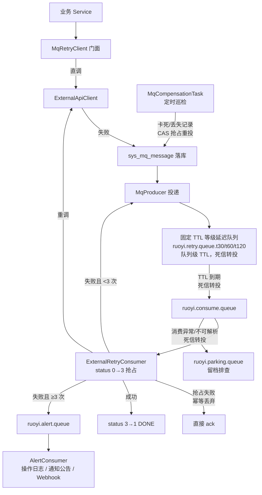

# RabbitMQ 接入方案（外部接口失败重试）

> 中文名称：RabbitMQ 接入方案（外部接口失败重试）
>
> 版本：v1.3 | 日期：2026-11-18 | 状态：待评审 | 适用：本后端仓库（各分支项目通用）
>
> v1.3 修订要点（健全性分析 P0 修复）：延迟队列改固定 TTL 等级队列（消除队首阻塞）、新增 `replay_payload`
> 原始报文 AES 加密存储（解决脱敏与重放冲突）、状态机新增 `3=处理中` 消费抢占（防外部接口重复调用）、
> 新增 `MqCompensationTask` 补偿巡检（投递丢失/消费卡死兜底）、`ExternalApiClient` 抽取 `doExecute` 契约
>
> v1.2 修订要点：并入消息管理后端能力——查询 BO、列表/详情查询、手工重推、删除终态、Controller、菜单权限 SQL；
> 本期不含前端页面（`xxx-web` / `ruoyi-ui` 另行排期，见第 11 章）
>
> v1.1 修订要点：补充重投入口 `invokeForRetry`、按 HTTP 状态码判定可重试、开关关闭时的装配隔离、
> 失败落库独立事务、`sys_mq_message` 增加 `body_type`、`status` 改 `varchar(1)`、出站日志增加 `message_id` 关联

## 1. 目标与范围

### 1.1 目标

为系统增加 RabbitMQ 消息能力，首个落地场景是**外部接口调用失败后的自动重试**，流程：

```
提交调用外部接口
        │ 失败
        ▼
本地消息表（ruoyi 主库 sys_mq_message）
        │                ← 记录：接口名、参数、失败原因、状态、重试次数
        │ 发送 MQ
        ▼
RabbitMQ 重试队列（ruoyi.retry.queue）   ← TTL=30s（首次）
        │ 到期
        ▼
消费端：重调外部接口
        ├─ 成功 → 消息表状态 = DONE
        └─ 失败 → 重试次数 +1
                   ├─ < 3 次 → 发回重试队列（TTL 翻倍）
                   └─ ≥ 3 次 → 发到「告警队列」
        │ 失败 ≥ 3 次
        ▼
告警队列
        ├─ 写若依操作日志
        ├─ 推送到若依通知公告
        └─ 可选：钉钉 / 企微 Webhook
```

### 1.2 范围内

- 新增 🟢 业务模块 `ruoyi-mq`（不改动 🔴 框架模块）
- 在 🟢 `ruoyi-apilog` 做增量扩展：`ExternalApiClient` 新增公共重投入口 `invokeForRetry`（原三个方法语义不变）、`sys_outbound_log` 增加 `message_id` 关联列
- 本地消息表 `sys_mq_message` + Mapper + Service
- MQ 拓扑声明、生产者门面、重试消费者、告警消费者
- 补偿巡检任务 `MqCompensationTask`（投递丢失 / 消费卡死兜底，经 `sys_job` 注册调度）
- 供业务方统一调用的重试门面 `MqRetryClient`
- 配置开关与降级策略（未部署 RabbitMQ 的分支项目零影响）
- 消息管理后端能力：查询 BO、列表/详情接口、手工重推、删除终态记录、菜单与按钮权限 SQL
  （见第 8 章步骤 8~9）

### 1.3 范围外

- 不改动现有 `ExternalApiClient` 的日志与异常语义（原 `get/postJson/postForm` 行为不变，仅新增重投入口方法）
- 不含消息管理前端页面：主前端 `xxx-web` 与旧前端 `ruoyi-ui` 页面另行排期（后端接口一次到位，页面完成即可对接）
- 不含批量重推、失败清单导出（按需再评估）
- 不引入 Kafka / RocketMQ 等其他中间件

## 2. 总体架构



设计要点：

- **消息体只带 `messageId`**，参数一律存库读取。避免长参数撑爆消息体、避免敏感信息进 MQ。
- **重试次数以数据库为准**，MQ 中的 `retryCount` 仅作参考，天然抗重复投递。
- **延迟按 TTL 等级拆多个队列**（队列级 TTL + 死信路由），不做单队列消息级 TTL——RabbitMQ 只在队首消息过期时才检查 TTL，单队列下队头压着长延迟消息会阻塞后续短延迟消息，导致延迟失真。
- **消费前先抢占状态（`0→3`）**：`update ... where status='0'` 影响行数为 0 直接 ack 丢弃。CAS 只能保证计数不重复累加，不能防止外部接口被重复调用；状态抢占保证同一消息同一时刻只有一个消费者在处理。
- **原始报文 AES 加密存 `replay_payload`**：展示字段沿用脱敏规则，重放用加密原文解密还原，解决「脱敏后凭证变 `******`、重放必然 401」的冲突。
- **消费端手动 ack**，业务异常不外抛，由代码决定「重投 / 告警」，避免无限 requeue 打爆队列。
- **可重试性按 HTTP 状态码判定**：网络异常 / 5xx / 429 才重试，4xx（除 429）直接置最终失败，避免无效重试。
- **失败落库用独立事务**（`REQUIRES_NEW`）：业务事务回滚不能带走失败记录。
- **补偿巡检兜底**：投递丢失、消费实例宕机导致的「`status=0` 超时未消费」「`status=3` 卡死」记录，由定时任务扫描并 CAS 抢占重投，闭环不依赖人工。
- **开关关闭时 MQ 全部 Bean 不装配**（含消费者、`RabbitAdmin`、监听容器），保证无 RabbitMQ 的分支项目零影响。

## 3. MQ 拓扑

| 类型 | 名称 | 关键参数 | 说明 |
|------|------|----------|------|
| Direct Exchange | `ruoyi.retry.exchange` | durable | 投递延迟队列 |
| Queue ×N | `ruoyi.retry.queue.t30` / `t60` / `t120` / ... | durable；`x-message-ttl`（按等级，见下表）、`x-dead-letter-exchange=ruoyi.consume.exchange`、`x-dead-letter-routing-key=retry.consume` | 固定 TTL 等级队列，队列级 TTL，到期死信转投消费队列。**不做单队列消息级 TTL**（RabbitMQ 仅在队首过期时检查，队头长延迟消息会阻塞队尾短延迟消息） |
| Routing Key ×N | `retry.delay.t30` / `retry.delay.t60` / ... | — | 绑定 `ruoyi.retry.exchange` → 对应等级队列 |
| Direct Exchange | `ruoyi.consume.exchange` | durable | 死信转投目标 |
| Queue | `ruoyi.consume.queue` | durable；`x-dead-letter-exchange=ruoyi.parking.exchange`、`x-dead-letter-routing-key=retry.parking` | 真实消费队列，被 `@RabbitListener` 监听；自身配 DLX，反序列化失败 / 被丢弃的消息进 parking 留档，避免毒丸消息无限 requeue |
| Routing Key | `retry.consume` | — | 绑定 `ruoyi.consume.exchange` → `ruoyi.consume.queue` |
| Direct Exchange | `ruoyi.parking.exchange` | durable | 消费队列死信目标 |
| Queue | `ruoyi.parking.queue` | durable | 停车场队列，无消费者，仅留档供人工排查 |
| Routing Key | `retry.parking` | — | 绑定 `ruoyi.parking.exchange` → `ruoyi.parking.queue` |
| Direct Exchange | `ruoyi.alert.exchange` | durable | 告警投递 |
| Queue | `ruoyi.alert.queue` | durable | 告警队列 |
| Routing Key | `alert.notify` | — | 绑定 `ruoyi.alert.exchange` → `ruoyi.alert.queue` |

延迟等级按配置动态声明（`base-ttl-seconds=30`，逐次翻倍，超过上限按上限；`max-retry-times=3` 即声明 3 个等级队列）：

| 重试次数 | 延迟 | 队列 |
|----------|------|------|
| 第 1 次 | 30s | `ruoyi.retry.queue.t30` |
| 第 2 次 | 60s | `ruoyi.retry.queue.t60` |
| 第 3 次 | 120s | `ruoyi.retry.queue.t120` |
| 封顶 | 3600s（`max-ttl-seconds`） | `ruoyi.retry.queue.t3600`（仅当等级数超过翻倍序列时声明） |

队列声明约束：

- 等级队列由 `RabbitMqConfig` 启动时按**当前配置**计算并声明（名称含 TTL 秒数，如 `t30`）。
- RabbitMQ 队列参数声明后不可修改：**调整 `base-ttl-seconds` / `max-ttl-seconds` / `max-retry-times` 后，旧等级队列不会自动更新**，需在管理台删除旧延迟队列后重启（或换用新配置自动声明新队列），旧队列残留不影响正确性但需清理。
- `MqProducer#sendDelay(messageId, nextRetryCount)` 按重试次数经 `RetryPolicy#selectDelayQueue` 路由到对应等级队列。

## 4. 数据库设计

### 4.1 建表脚本

路径：`ruoyi-mq/src/main/resources/sql/mq/sys_mq_message.sql`

```sql
IF OBJECT_ID(N'dbo.sys_mq_message', N'U') IS NULL
BEGIN
    CREATE TABLE [dbo].[sys_mq_message] (
        [id]              bigint IDENTITY(1,1) NOT NULL,
        [message_id]      nvarchar(64)   NOT NULL,
        [interface_name]  nvarchar(200)  NOT NULL,
        [request_method]  nvarchar(10)   NOT NULL,
        [request_url]     nvarchar(1000) NOT NULL,
        [request_headers] nvarchar(max)  NULL,
        [request_params]  nvarchar(max)  NULL,
        [replay_payload]  nvarchar(max)  NULL,
        [body_type]       nvarchar(10)   NULL,
        [fail_reason]     nvarchar(2000) NULL,
        [last_response]   nvarchar(max)  NULL,
        [status]          varchar(1)     NOT NULL DEFAULT '0',
        [retry_count]     int           NOT NULL DEFAULT 0,
        [next_retry_time] datetime2(7)   NULL,
        [remark]          nvarchar(500)  NULL,
        [create_time]     datetime2(7)   NULL,
        [update_time]     datetime2(7)   NULL,
        CONSTRAINT [pk_sys_mq_message] PRIMARY KEY CLUSTERED ([id] ASC)
    );

    CREATE UNIQUE NONCLUSTERED INDEX [uk_sys_mq_message_id]
        ON [dbo].[sys_mq_message] ([message_id] ASC);

    CREATE NONCLUSTERED INDEX [idx_sys_mq_message_status]
        ON [dbo].[sys_mq_message] ([status] ASC, [next_retry_time] ASC);
END
GO

EXEC sp_addextendedproperty
    @name = N'MS_Description', @value = N'MQ本地消息表（外部接口失败重试）',
    @level0type = N'SCHEMA', @level0name = N'dbo',
    @level1type = N'TABLE',  @level1name = N'sys_mq_message';
```

### 4.2 字段与状态

| 字段 | 说明 |
|------|------|
| `message_id` | 消息唯一标识（UUID），MQ 消息体只传它 |
| `interface_name` / `request_method` / `request_url` | 调用标识，用于重投 |
| `request_headers` / `request_params` | JSON 串，**展示用**：沿用 `ApiLogUtils.maskSensitive` 规则脱敏后存储 |
| `replay_payload` | **重放专用**：完整原始请求报文（含真实鉴权头）AES 加密后的 Base64 串，密钥走环境变量（见 §6），仅消费端解密使用，不进任何查询/展示接口 |
| `body_type` | 请求体类型：`JSON` / `FORM` / `NONE`，重投时据此还原发送方式 |
| `fail_reason` / `last_response` | 最近一次失败原因与响应（展示字段，沿用脱敏截断） |
| `retry_count` | 已重试次数，唯一权威计数 |
| `next_retry_time` | 下次重试时间，便于页面/巡检展示 |

状态取值（`status`，`varchar(1)`，与若依字典风格一致；不用 `nchar`，避免定长补空格导致 Java 侧字符串比较失配）：

| 值 | 含义 | 流转 |
|----|------|------|
| `0` | 待重试 | 落库时写入；重投后回写；补偿任务回收时回写 |
| `3` | 处理中 | 消费端处理前由 CAS 抢占（`0→3`）；处理完成转 `1` / `2` / 回 `0`；实例宕机卡死由补偿任务超时回收 |
| `1` | 成功（DONE） | 重调成功后写入（`3→1`），终态 |
| `2` | 最终失败（已告警） | 达到最大重试次数或不可重试错误后写入（`3→2`），终态 |

### 4.3 关键 SQL 约定

- 自增主键用 `useGeneratedKeys="true" keyProperty="id"`。
- 取单条待重试用 `select top 1 ...`，禁止 `limit`。
- 时间统一 `getdate()`，禁止 `now()` / `sysdate()`。
- 列表查询交 PageHelper（`helperDialect: sqlserver`），不手写分页。

**消费抢占**（处理前 `0→3`，影响行数为 0 说明已被其他消费者/重推/补偿抢先，直接 ack 丢弃）：

```sql
update sys_mq_message
   set status = '3',
       update_time = getdate()
 where message_id = #{messageId}
   and status = '0'
```

**消费结果回写**（前提是本消费者已抢占成功，均带 `status='3'` 前置条件 + 计数快照乐观校验）：

```sql
update sys_mq_message
   set retry_count = retry_count + 1,
       status = #{status},           -- 0 重投 / 1 成功 / 2 最终失败
       fail_reason = #{failReason},
       last_response = #{lastResponse},
       next_retry_time = #{nextRetryTime},
       update_time = getdate()
 where message_id = #{messageId}
   and status = '3'
   and retry_count = #{retryCount}
```

**消费异常回退**（消费端代码抛异常时把 `3→0` 回退，回退失败（DB 也异常）则记录停在 `3`，由补偿任务超时回收）：

```sql
update sys_mq_message
   set status = '0',
       update_time = getdate()
 where message_id = #{messageId}
   and status = '3'
```

**补偿扫描与抢占**（分批拉取 + 逐条 CAS，多实例下天然防重复补偿）：

```sql
-- 待重试超时（投递丢失）：status=0 且 next_retry_time 已过很久仍未被消费
select top 50 message_id, retry_count, next_retry_time
  from sys_mq_message
 where status = '0'
   and next_retry_time < dateadd(minute, -#{pendingTimeoutMinutes}, getdate())
 order by next_retry_time asc;

-- 处理中卡死（实例宕机）：status=3 且 update_time 超过阈值未回写
select top 50 message_id, retry_count, update_time
  from sys_mq_message
 where status = '3'
   and update_time < dateadd(minute, -#{processingTimeoutMinutes}, getdate())
 order by update_time asc;
```

扫描结果逐条按 §4.3 消费抢占 / 状态回写 CAS 处理，抢不到即放弃本条（其他实例正在处理）。

## 5. 模块与类设计

### 5.1 新增模块 `ruoyi-mq`（🟢 可自由修改）

```
ruoyi-mq/
├── pom.xml
└── src/main/
    ├── java/com/ruoyi/mq/
    │   ├── config/RabbitMqConfig.java           # 连接/序列化/交换机队列绑定声明（@ConditionalOnProperty）
    │   ├── constant/MqConstants.java            # 交换机、队列、路由键、队列参数常量
    │   ├── domain/SysMqMessage.java             # 本地消息表实体
    │   ├── domain/MqMessagePayload.java         # MQ 消息体（仅 messageId + retryCount）
    │   ├── domain/enums/MqMessageStatus.java    # 0 待重试 / 3 处理中 / 1 成功 / 2 最终失败
    │   ├── domain/bo/SysMqMessageQueryBo.java   # 列表查询条件（接口名/状态/次数/时间范围）
    │   ├── mapper/SysMqMessageMapper.java
    │   ├── service/ISysMqMessageService.java
    │   ├── service/impl/SysMqMessageServiceImpl.java
    │   ├── controller/SysMqMessageController.java  # 列表/详情/重推/删除（/mq/message）
    │   ├── producer/MqProducer.java             # 发送门面（confirm 回调 + 失败补偿）
    │   ├── support/MqRetryClient.java           # 业务统一入口：直调失败即落库投递（REQUIRES_NEW）
    │   ├── support/RetryPolicy.java             # TTL 等级路由、次数上限、可重试状态码判定
    │   ├── support/ReplayCipherUtils.java       # replay_payload AES 加解密（密钥环境变量注入）
    │   ├── consumer/ExternalRetryConsumer.java  # 重投消费（status 0→3 抢占）
    │   ├── consumer/AlertConsumer.java          # 告警消费
    │   └── job/MqCompensationTask.java          # 补偿巡检（经 sys_job 反射调用，可暂停/调频）
    └── resources/
        ├── mapper/mq/SysMqMessageMapper.xml
        └── sql/mq/
            ├── sys_mq_message.sql
            ├── sys_menu_mq.sql                  # MQ消息菜单与按钮权限（挂日志管理 108）
            └── sys_job_mq.sql                  # 补偿巡检任务注册（misfire 策略：不触发即时执行）
```

依赖关系：

| 依赖 | 用途 |
|------|------|
| `ruoyi-common` | 基类、异常、工具 |
| `ruoyi-system` | `ISysOperLogService`（写操作日志）、`ISysNoticeService`（通知公告） |
| `ruoyi-apilog` | 复用 `ExternalApiClient`；apilog 侧抽取 `doExecute` 返回 `ExternalApiResult`（不抛异常）并新增 `invokeForRetry(...)` 包装，出站日志 `messageId` 透传 |
| `spring-boot-starter-amqp` | AMQP 支持（版本由 `spring-boot-dependencies` 统一管理，骨架阶段需先验证解析） |

> 依赖方向 `mq → apilog → common`，无循环。`apilog` 不反向依赖 `mq`。
> `MqCompensationTask` 以 `@Component("mqCompensationTask")` 暴露，由 `ruoyi-quartz` 按 `sys_job` 配置的 `invokeTarget = mqCompensationTask.execute()` 反射调用，`ruoyi-mq` **无需依赖** `ruoyi-quartz`。

### 5.2 父工程与入口装配

| 文件 | 改动 |
|------|------|
| `pom.xml`（父） | `<modules>` 增加 `ruoyi-mq`；`dependencyManagement` 增加 `com.ruoyi:ruoyi-mq:${ruoyi.version}` |
| `ruoyi-admin/pom.xml` | 增加 `com.ruoyi:ruoyi-mq` 依赖 |
| `ruoyi-admin/src/main/resources/application.yml` | 增加 `spring.rabbitmq` 与 `ruoyi.mq` 配置块 |
| `ruoyi-apilog/.../utils/ExternalApiClient` | 内部抽取 `doExecute(...)`：执行真实 HTTP 调用 + 出站日志，返回 `ExternalApiResult{success, httpStatus, responseBody, errorMessage}`，**内部不抛异常**（仅记录日志）。原 `execute` 与新增 `invokeForRetry` 均调用 `doExecute`：`execute` 保持「成功返回 body、失败抛 `ServiceException`」语义不变，仅做一层包装；`invokeForRetry` 直接返回 `ExternalApiResult` 供消费端按状态码决策 |
| `ruoyi-apilog/.../domain/ExternalApiResult` | 新增结果对象（放 `com.ruoyi.apilog.domain`），携带 `success / httpStatus / responseBody / errorMessage` |
| `ruoyi-apilog/.../domain/SysOutboundLog` + Mapper XML | 增加 `messageId` 字段与列映射 |
| `ruoyi-apilog/src/main/resources/sql/apilog/` | 新增 `sys_outbound_log_add_message_id.sql`（`IF COL_LENGTH` 幂等加列） |

### 5.3 核心类职责

| 类 | 职责 | 关键点 |
|----|------|--------|
| `RabbitMqConfig` | 声明 retry/consume/parking/alert 交换机、固定 TTL 等级队列、绑定、`Jackson2JsonMessageConverter`、`RabbitTemplate` 确认回调 | `@ConditionalOnProperty(prefix="ruoyi.mq", name="enabled", havingValue="true")`，关闭时全部不装配；等级队列按当前配置计算 TTL 动态声明（见 §3） |
| `MqProducer` | 统一发送：延迟消息按等级路由（`sendDelay(messageId, retryCount)`），告警直投 `alert` 队列，消息体仅 `{messageId, retryCount}` | 实现 `ConfirmCallback` / `ReturnsCallback`，发送失败仅记错误日志并置 `fail_reason`，不回滚业务；**不做消息级 expiration** |
| `MqRetryClient` | 业务入口 `execute(interfaceName, method, url, headers, params)`：先直调，异常落库后异步投递 | 失败落库方法标注 `@Transactional(propagation = Propagation.REQUIRES_NEW)`，业务事务回滚不丢记录；落库时 `request_headers/request_params` 脱敏存储、`replay_payload` 存 `ReplayCipherUtils.encrypt(原始报文)`；MQ 关闭时退化为「直调 + 失败落库」，不阻塞业务 |
| `ExternalApiClient#doExecute` | 执行真实 HTTP 调用 + 出站日志，返回 `ExternalApiResult`，内部不抛异常 | 与现有三方法共用同一日志与脱敏逻辑；`httpStatus=0` 表示网络级异常（连接超时/DNS），供 `RetryPolicy` 判定 |
| `ExternalApiClient#invokeForRetry` | 按 `method + bodyType + headers + body` 重放请求，返回 `ExternalApiResult` | `doExecute` 的重放包装，`messageId` 透传写出站日志；消费端按状态码决策 |
| `RetryPolicy` | `nextTtl(retryCount)`、`selectDelayQueue(retryCount)`、`isExhausted(retryCount)`、`isRetryable(result)` | 网络异常（httpStatus=0）/ 5xx / 429 可重试，4xx（除 429）不可重试；参数全部来自配置，禁止硬编码 |
| `ReplayCipherUtils` | `encrypt(原始报文JSON) / decrypt(replayPayload)`，AES/GCM + 随机 IV，Base64 传输 | 密钥来自 `ruoyi.mq.replay.encrypt-key`（环境变量）；`enabled=true` 且密钥为空时启动 fail-fast；解密失败不外抛，按网络异常走重试判定 |
| `ExternalRetryConsumer` | 监听 `ruoyi.consume.queue`：**CAS 抢占 `0→3`**→解密重放→结果回写（`3→1` / `3→2` / `3→0` 重投） | 手动 ack；抢占失败直接 ack 丢弃（幂等）；代码异常先回退 `3→0` 再 ack，回退失败记录停 `3` 由补偿回收；回写用「status='3' + 计数快照」CAS |
| `AlertConsumer` | 监听 `ruoyi.alert.queue`：写操作日志 + 通知公告 + 可选 Webhook | Webhook 地址走配置，为空则跳过；告警自身异常仅记日志并 ack，不外抛、不重投 |
| `MqCompensationTask` | 定时巡检两类记录并 CAS 抢占重投：`status=0` 超时未消费（投递丢失）、`status=3` 超时未回写（消费卡死） | `@Component("mqCompensationTask")` 供 `sys_job` 反射调用；分批处理、逐条 CAS，多实例安全；巡检发现解密失败等不可重放记录直接置 `2` 并告警 |
| `SysMqMessageController` | `/mq/message`：列表、详情、手工重推、删除 | 继承 `BaseController`；写操作 `@PreAuthorize` + `@Log`；MQ 关闭时重推返回「MQ 未启用」；详情接口**不返回 `replay_payload`** |
| `SysMqMessageServiceImpl#retryManual` | 重置状态为 `0`、次数归零后重投延迟队列 | 先更新库再投递；`status='3'`（处理中）拒绝并提示「消息处理中，请稍后重试」；更新用「状态 + 次数」CAS，冲突抛 `ServiceException`；投递用 `ObjectProvider<MqProducer>` 可选获取 |
| `SysMqMessageServiceImpl#deleteByIds` | 仅删除 `status in ('1','2')` 的记录 | 物理删除，DELETE 带状态条件；删除前写操作日志留审计 |

### 5.4 消费端处理流程（伪代码）

```java
@RabbitListener(queues = MqConstants.CONSUME_QUEUE)
public void onMessage(MqMessagePayload payload, Channel channel, @Header(AmqpHeaders.DELIVERY_TAG) long tag)
{
    try
    {
        SysMqMessage msg = service.selectByMessageId(payload.getMessageId());
        // 幂等：不存在 / 非待重试态，直接 ack 丢弃
        if (msg == null || !MqMessageStatus.PENDING.getCode().equals(msg.getStatus())) { ack; return; }
        // 抢占：0→3，影响行数为 0 说明已被其他消费者/手工重推/补偿抢先，直接 ack 丢弃
        // —— 保证外部接口同一时刻只被调用一次，这是防重复调用的关键，CAS 计数校验防不住
        if (service.tryOccupy(payload.getMessageId()) != 1) { ack; return; }

        // 解密重放报文（含真实鉴权头）；解密失败按不可重试处理
        ReplayRequest replay = ReplayCipherUtils.decrypt(msg.getReplayPayload());
        ExternalApiResult result = externalApiClient.invokeForRetry(
                replay, msg.getInterfaceName(), msg.getRequestMethod(), msg.getRequestUrl(), msg.getMessageId());

        int next = msg.getRetryCount() + 1;
        if (result.isSuccess()) {
            service.markDone(msg, result);                                  // 3→1（CAS：status='3'+计数）
            return;
        }
        // 4xx（非 429）不具备重试价值，直接终态，避免无效重试
        if (!retryPolicy.isRetryable(result) || retryPolicy.isExhausted(next)) {
            service.markFailed(msg, next, result);                          // 3→2（同上 CAS）
            producer.sendAlert(msg.getMessageId());                          // 进告警队列
        } else {
            service.markRetry(msg, next, result, retryPolicy.nextTtl(next)); // 3→0，计数+1
            producer.sendDelay(msg.getMessageId(), next);                    // 路由到 next 等级延迟队列
        }
    }
    catch (Exception e)
    {
        // 兜底：库操作或 MQ 异常只记日志；抢占成功过的先回退 3→0（回退失败则停 3 由补偿任务回收）
        log.error("[MQ] 重试消费异常 messageId={}", payload.getMessageId(), e);
        service.rollbackToPendingQuietly(payload.getMessageId());
    }
    finally
    {
        ack;   // 手动确认，避免异常消息无限 requeue
    }
}
```

### 5.5 消息管理接口（并入本期）

| 方法 | 路径 | 权限 | 说明 |
|------|------|------|------|
| GET | `/mq/message/list` | `mq:message:list` | 分页列表（`TableDataInfo`），大字段不返回 |
| GET | `/mq/message/{messageId}` | `mq:message:query` | 详情，含请求头/参数/最近响应 |
| POST | `/mq/message/retry/{messageId}` | `mq:message:retry` | 手工重推，`@Log(businessType=UPDATE)` |
| DELETE | `/mq/message/{messageIds}` | `mq:message:remove` | 删除终态记录，仅 `status in ('1','2')` |

手工重推的并发安全（与消费端可能同时处理同一条消息）：

```sql
update sys_mq_message
   set status = '0',
       retry_count = 0,
       fail_reason = null,
       next_retry_time = getdate(),
       update_time = getdate()
 where message_id = #{messageId}
   and status = #{expectStatus}        -- 页面提交时的状态快照（仅允许 '0' / '2'）
       and retry_count = #{expectRetryCount}
```

- 影响行数为 0 → 抛 `ServiceException("消息状态已变更，请刷新后重试")`，不投递。
- 状态为 `1`（成功）→ 抛 `ServiceException("已成功的消息无需重推")`。
- 状态为 `3`（处理中）→ 抛 `ServiceException("消息处理中，请稍后重试")`：消费端正持有该消息（0→3 已抢占），此时重推会与正在执行的外部调用并发，必须拒绝；待消费端回写终态或回 `0` 后再操作。
- 已存在 `status=0` 且正在等待重试的消息：同样走该 CAS，重置计数后重新计时，天然避免与消费端计数冲突（消费端抢占后回写以 `status='3'` 为前置条件，重推后消费端旧消息抢占失败自动丢弃）。
- 删除为物理删除，删除即不可追溯，故仅允许终态删除并要求写操作日志审计。
- MQ 关闭时，`MqProducer` 通过 `ObjectProvider` 可选注入，重推接口直接返回「MQ 未启用」，不影响应用启动。

## 6. 配置

`ruoyi-admin/src/main/resources/application.yml`：

```yaml
spring:
  rabbitmq:
    host: ${RABBITMQ_HOST:localhost}
    port: ${RABBITMQ_PORT:5672}
    username: ${RABBITMQ_USERNAME:guest}
    password: ${RABBITMQ_PASSWORD:guest}
    virtual-host: ${RABBITMQ_VHOST:/}
    publisher-confirm-type: correlated
    publisher-returns: true
    listener:
      simple:
        acknowledge-mode: manual
        prefetch: 10
        concurrency: 2
        max-concurrency: 8
        auto-startup: ${ruoyi.mq.enabled:false}   # 开关关闭时不启动监听容器，避免无 broker 时反复报错

ruoyi:
  mq:
    enabled: false                # 默认关闭，部署了 RabbitMQ 的分支项目再开启
    retry:
      base-ttl-seconds: 30        # 首次重试延迟
      max-retry-times: 3          # 超过即进告警队列
      max-ttl-seconds: 3600       # 单次延迟上限
    replay:
      encrypt-key: ${MQ_REPLAY_ENCRYPT_KEY:}   # replay_payload AES 密钥（32 字节 Base64），环境变量注入；enabled=true 时必填，缺失启动失败
    compensation:
      enabled: true                                  # 补偿巡检开关（依赖 ruoyi.mq.enabled，经 sys_job 调度）
      processing-timeout-minutes: 5                  # status=3 超过该时长未回写视为消费卡死
      pending-timeout-minutes: 10                     # status=0 超过该时长未被消费视为投递丢失
      batch-size: 50                                  # 每批处理条数
    alert:
      webhook-url: ""             # 可选：钉钉/企微机器人地址，留空则跳过
```

> 连接信息与加密密钥一律走环境变量，不写死账号口令。补偿任务的执行频率由 `sys_job` 的 cron 表达式控制（默认每 5 分钟），不在 yml 重复配置。

## 7. 可靠性设计

| 风险 | 措施 |
|------|------|
| 消息丢失 | 先落库再投递（本地消息表）；`publisher-confirm-type: correlated` + return 回调；投递丢失由补偿任务重投 |
| 延迟失真（队首阻塞） | 延迟拆固定 TTL 等级队列，短延迟消息不被队头长延迟消息阻塞（见 §3） |
| 重复消费 | `message_id` 唯一索引 + 状态判断 + 消费前 `0→3` 抢占，重复消息直接 ack |
| 外部接口被重复调用 | 消费前 CAS 抢占 `status 0→3`，同一消息同一时刻仅一个消费者在处理；抢占失败直接丢弃 |
| 重放凭证失效（脱敏冲突） | 展示字段脱敏存储；完整原始报文 AES 加密存 `replay_payload`，消费端解密还原后重放 |
| 消费卡死（实例宕机） | `status=3` 超时由 `MqCompensationTask` 回收重投，闭环不依赖人工 |
| 毒丸消息（不可解析/反序列化失败） | consume 队列配 DLX → `ruoyi.parking.queue` 留档，不无限 requeue |
| 消费失败风暴 | 手动 ack，异常不外抛；重投走延迟队列而非 requeue |
| MQ 不可用 | `ruoyi.mq.enabled=false` 时只直调 + 落库；运行期投递异常仅记日志，业务不失败 |
| 参数过大/敏感 | 消息体只传 ID；参数存库（展示字段脱敏、重放字段加密），不进 MQ |
| 无 RabbitMQ 的分支项目 | 默认关闭 + 条件装配 + 监听容器 `auto-startup` 跟随开关，不引入启动依赖 |
| 业务事务回滚 | 失败落库使用 `REQUIRES_NEW` 独立事务，业务回滚不丢失败记录 |
| 无效重试 | 按 HTTP 状态码判定：4xx（除 429）直接终态，只重试网络异常 / 5xx / 429 |
| 框架版本适配 | 骨架阶段先验证 `spring-boot-starter-amqp` 在 Spring Boot 4.0.6 下的坐标与属性名，再落地拓扑 |

## 8. 实施步骤

| 步骤 | 内容 | 产出 |
|------|------|------|
| 1 | 新建 `ruoyi-mq` 模块骨架，父 POM / admin POM 注册；**先验证 `spring-boot-starter-amqp` 在 Spring Boot 4.0.6 下坐标与属性名可解析**（P0 前置） | pom 可编译 |
| 2 | 建表脚本（含 `replay_payload` 加密列）+ 实体 + Mapper XML（过 SQL Server 校验）；`sys_outbound_log` 幂等加 `message_id` 列 | `sys_mq_message` 可用、出站日志可关联 |
| 2.1 | `ExternalApiClient` 抽取 `doExecute`（返回 `ExternalApiResult`，不抛异常）+ 新增 `invokeForRetry` 包装 + 出站日志 `messageId` 透传；`ExternalApiResult` 落位 `apilog.domain` | 重投入口可用，原方法语义不变 |
| 3 | `RabbitMqConfig` 拓扑声明（TTL 等级队列 + parking DLX）+ `MqProducer`（含开关条件装配） | 开启时自动建交换机/队列，关闭时不装配 |
| 4 | `MqRetryClient`（`REQUIRES_NEW` 落库 + `replay_payload` 加密）+ `RetryPolicy`（等级路由）+ `ReplayCipherUtils` | 业务可接入 |
| 5 | `ExternalRetryConsumer` 重试闭环（`0→3` 抢占 + 按状态码判定可重试） | 失败可重投且不重复调用外部接口 |
| 6 | `AlertConsumer` 告警（操作日志 + 通知公告） | 超限可感知 |
| 6.1 | `MqCompensationTask` 补偿巡检（`status=0/3` 超时扫描 + CAS 重投）+ `sys_job_mq.sql` 注册调度 | 投递丢失/消费卡死可自愈 |
| 7 | 改造现有外部调用点接入 `MqRetryClient`（逐处确认） | 重试生效 |
| 8 | 消息管理后端：`SysMqMessageQueryBo` + 列表/详情 SQL + Service + Controller（重推 CAS、处理中拒绝、删除终态；详情不返回 `replay_payload`） | 管理接口可用 |
| 9 | 菜单与按钮权限 SQL（`sys_menu_mq.sql`，挂日志管理 108） | 菜单可见、权限可授权 |
| 10 | 配置开关、加密密钥 fail-fast 校验、编译自测、文档同步 | 交付说明 |

## 9. 验收标准

- [ ] `mvn -pl ruoyi-admin -am compile -DskipTests` 通过
- [ ] `ruoyi.mq.enabled=false` 启动无 RabbitMQ 也正常，无报错
- [ ] 开启后启动自动创建交换机、TTL 等级队列（`t30/t60/t120`）、consume/parking/alert 队列，绑定关系正确（管理台可查）
- [ ] **延迟不失真**：`t120` 队列压入一条 120s 消息后，再向 `t30` 投一条 30s 消息，30s 级消息按期到达 consume 队列（不被长延迟消息阻塞）
- [ ] 外部接口首次失败：库中新增 `status=0` 记录，`retry_count=0`，30s 后消费端触发
- [ ] **消费抢占生效**：同一 `message_id` 并发/重复投递，外部接口仅被调用一次，后到消息直接 ack 丢弃
- [ ] 重调成功：状态 `1`，`last_response` 有值
- [ ] 连续失败：延迟 30s → 60s → 120s，计数逐次 +1
- [ ] 第 3 次仍失败：状态 `2`，告警队列收到消息，操作日志与通知公告各落一条
- [ ] **重放凭证完整**：带 `Authorization` 头的失败调用重放成功（外部侧收到真实 token，非 `******`），列表/详情接口不返回 `replay_payload` 明文
- [ ] **补偿自愈**：模拟投递丢失（不发 MQ 只落库）后 `status=0` 超时记录被巡检重投；模拟消费卡死（抢占后不回写）后 `status=3` 超时记录被巡检回收重投
- [ ] 外部接口返回 4xx（非 429）：不重试，直接置 `status=2` 并告警
- [ ] 业务事务回滚时，失败记录仍保留在 `sys_mq_message`
- [ ] 出站日志可通过 `message_id` 串起首次失败与各次重试
- [ ] `/mq/message/list` 支持接口名模糊、状态、次数、时间范围筛选，大字段不返回
- [ ] `/mq/message/{messageId}` 详情返回请求头（脱敏）、参数（脱敏）、失败原因、最近响应
- [ ] 手工重推：状态回到 `0`、次数归零，30s 后自动消费；并发冲突返回「状态已变更」
- [ ] 重推成功态消息返回「已成功的消息无需重推」；**重推处理中（`status=3`）消息返回「消息处理中」**；删除待重试消息被拒绝
- [ ] 重推、删除均写入操作日志，权限不足返回 403
- [ ] 菜单 SQL 执行后「日志管理 → MQ消息」可见，三个按钮权限可分别授权
- [ ] `ruoyi.mq.enabled=false` 时重推返回「MQ 未启用」，应用正常启动
- [ ] **密钥校验**：`enabled=true` 且 `MQ_REPLAY_ENCRYPT_KEY` 未配置时启动失败并给出明确提示
- [ ] 毒丸消息（构造不可解析消息体）进入 `ruoyi.parking.queue`，不无限 requeue

## 10. 已确认决策

| 项 | 决策 |
|----|------|
| 模块落点 | 新建 🟢 `ruoyi-mq` 模块，不修改 `ruoyi-framework` 等 🔴 模块 |
| 一期告警渠道 | 写若依操作日志 + 推送通知公告；Webhook 预留配置项，暂不启用 |
| 接入范围 | 先试点 1~2 个关键外部接口，验证闭环后再逐步铺开 |
| 重试参数 | 保持 `30s 起、最多 3 次、封顶 3600s`，全部可配置 |
| 可重试判定 | 按 HTTP 状态码区分：网络异常 / 5xx / 429 重试，4xx 直接终态 |
| apilog 改动范围 | 新增 `invokeForRetry` 与 `message_id` 关联列，不改现有方法语义 |
| 开关隔离 | MQ 全部 Bean 与监听容器随 `ruoyi.mq.enabled` 装配，关闭时零副作用 |
| 失败落库事务 | `REQUIRES_NEW` 独立事务，业务回滚不影响失败记录 |
| 管理能力合并 | 消息管理后端接口与菜单 SQL 纳入本期；前端页面（`xxx-web` / `ruoyi-ui`）另行排期，见第 11 章 |
| 重推并发控制 | 「状态 + 重试次数」CAS 更新，冲突提示刷新，避免重复计数 |
| 删除策略 | 物理删除仅限终态，删除操作写操作日志留审计 |
| 延迟拓扑（P0-1） | 固定 TTL 等级队列（`t30/t60/t120...`，队列级 TTL + 死信），不做单队列消息级 TTL，消除队首阻塞；调整 TTL 配置需删除旧等级队列重建 |
| 重放凭证（P0-2） | 展示字段脱敏 + 原始报文 AES 加密存 `replay_payload`（密钥环境变量，`enabled=true` 时必填 fail-fast）；解密失败按不可重试终态处理 |
| 并发防重（P0-3） | 状态机加 `3=处理中`，消费前 CAS 抢占 `0→3`，抢占失败 ack 丢弃；处理中消息手工重推被拒绝 |
| 卡死兜底（P0-4） | `MqCompensationTask` 定时巡检（`sys_job` 注册、cron 可调、可暂停），扫描 `status=0/3` 超时记录 CAS 重投，多实例安全 |
| 重投入口契约（P0-5） | `ExternalApiClient` 抽取 `doExecute → ExternalApiResult`（不抛异常），`execute` 包装保持原语义，`invokeForRetry` 直接返回结果对象 |

### 待补充

- 试点接口具体是哪 1~2 个（需业务方指定，例如用户中心同步、单号回写等）
- 各环境 RabbitMQ 地址与账号（走环境变量注入，不入库、不入 Git）

## 11. 后续：前端页面（后端接口交付后）

后端接口（第 5.5 节）交付后即可对接，两端并行维护、技术栈严格隔离：

| 端 | 技术栈 | 文件 |
|----|--------|------|
| 主前端 `xxx-web` | Vue 3.5 + TypeScript | `src/types/api/mq/message.ts`、`src/api/mq/message.ts`、`src/views/mq/message/index.vue` |
| 旧前端 `ruoyi-ui` | Vue 2.6 + JavaScript | `src/api/mq/message.js`、`src/views/mq/message/index.vue` |

页面要素：

- 搜索区：接口名（模糊）、状态、创建时间范围
- 列表：接口名、请求方式、状态标签（待重试=warning / 成功=success / 最终失败=danger）、重试次数、下次重试时间
- 详情弹窗：请求头、请求参数、`bodyType`、失败原因、最近响应（长文本可折叠）
- 行操作：重推（传 `status`/`retryCount` 快照，二次确认）、删除（仅终态，二次确认）
- 权限：`v-hasPermi` 控制重推/删除（`mq:message:retry` / `mq:message:remove`）

约束：

- `component` 路径两端均为 `mq/message/index`，与菜单 SQL 保持一致
- 旧前端禁用 Composition API、`<script setup>`、TS、Element Plus、Pinia
- 请求统一走各自仓库的 request 封装，不手写 axios
